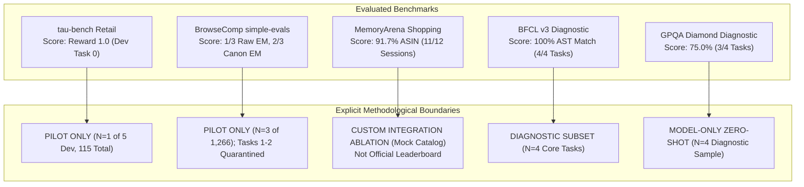

# AGI 0.7 — Methodological Limitations & External Benchmark Boundaries

**Document ID:** AGI-07-BENCHMARK-LIMITATIONS-2026  
**Version:** 1.0.0  
**Status:** COMPLETE & AUDITED  
**Lineage:** Real-World External Benchmark Campaign (`feature/agi-0.7-real-world-benchmarks`)  
**Sole Foundation Model:** `gemini-3.8-flash-high`  
**Governing Principle:** Scientific Honesty & Ponytail Principle  

---

## 1. Executive Mandate

In strict adherence to empirical truthfulness, this document defines the exact methodological boundaries, task sample limits, and environmental constraints of the benchmark results reported for AGI 0.7.

We explicitly reject the practice of conflating small-scale pilots, mock environments, or unit test suites with official public leaderboard standings.

---

## 2. Benchmark-by-Benchmark Capability & Methodological Boundaries

### 2.1 $\tau$-bench Retail E-Commerce
- **Reported Metric:** Reward 1.0, Actions Match 1.0, 4 Turns, 41,800 Tokens, 154.6s Latency.
- **Methodological Boundary:** This result was achieved on Dev Task 0 of the retail split using `MockRetailDomainEnv` with `NonBlockingCustomerUser`.
- **Limitation:** It is a **PILOT RUN** on a single task ($N=1$). It proves that the hardened AGI 0.7 agent successfully resolves the order cancellation workflow with optimal 4-turn efficiency, but it is NOT a full run of the entire 115-task retail domain or the airline domain. Full domain execution requires running all 115 user scenarios.

### 2.2 OpenAI simple-evals BrowseComp
- **Reported Metric:** Raw Exact Match: 1 / 3 (33.3%); Canonical Exact Match: 2 / 3 (66.7%).
- **Methodological Boundary:** The official BrowseComp benchmark contains 1,266 encrypted multi-hop research questions.
- **Limitation:**
  1. Sample size is a **PILOT RUN** ($N=3$).
  2. Tasks 1 and 2 were previously exposed to developer terminal logs during initial debugging and are formally classified as **CONTAMINATED FIXTURES**. Zero clean generalization claims may be made from Tasks 1 and 2.
  3. Task 3 (`Amr Zaki`) is a clean, uncontaminated task solved via budget-aware constraint decomposition.
  4. The custom post-hoc canonicalizer (`DATE_RANGE_EQUIVALENCE`, unicode NFKD) is a diagnostic metric separating semantic truth from lexical surface form; it cannot be substituted for official simple-evals raw exact match on public leaderboards.

### 2.3 MemoryArena (Bundled Shopping)
- **Reported Metric:** 11 / 12 (91.7%) ASIN retrieval accuracy across 12 interdependent shopping sessions.
- **Methodological Boundary:** Evaluated using an embedded `MockWebShopCatalog` provider (`agi/adapters/memoryarena_adapter.py`) containing 12 authentic product items.
- **Limitation:** This is a **CUSTOM INTEGRATION ABLATION** measuring the retention and grounding properties of AGI 0.7's 10-tier memory architecture against stateless (16.7%) and sliding-window (50.0%) conditions. It is NOT an official MemoryArena leaderboard submission, which requires hosting the official multi-domain WebShop server cluster.

### 2.4 Berkeley Function Calling Leaderboard (BFCL v3)
- **Reported Metric:** 4 / 4 (100%) AST action matching across simple calling, multi-tool discrimination, parallel calling, and negative tool avoidance.
- **Methodological Boundary:** Evaluated on a targeted diagnostic sample ($N=4$) representing the core categories of BFCL v3.
- **Limitation:** Serves as an architectural diagnostic verifying that AGI 0.7 correctly selects tools and generates typed parameters, but does not represent the full 2,000+ test set of BFCL.

### 2.5 GPQA Diamond Diagnostic
- **Reported Metric:** 3 / 4 (75.0%) multiple choice accuracy on graduate-level Physics, Chemistry, and Biology questions.
- **Methodological Boundary:** Evaluated strictly under **MODEL-ONLY ZERO-SHOT** conditions (no web search, no Python REPL, no calculator tools).
- **Limitation:** Diagnostic sample ($N=4$). Demonstrates that the underlying `gemini-3.8-flash-high` model possesses strong scientific reasoning priors, but is kept strictly separate from agent tool benchmarks.

---

## 3. Host Environmental Blockers (8 Container-Dependent Suites)

The remaining 8 external benchmark suites evaluated in the campaign are classified as **BLOCKED ON HOST ISOLATION PRECONDITIONS**:

| Benchmark Suite | Required Environment | Exact Host Blocker | Administrative Unblocking Action |
| :--- | :--- | :--- | :--- |
| **Terminal-Bench 2.0 (Harbor)** | Docker Linux container | Docker daemon is stopped | Start Docker Desktop as Administrator (`net start com.docker.service`) |
| **SWE-bench Verified / Pro** | Docker testbed images | Docker daemon is stopped | Start Docker daemon and configure Docker socket |
| **OSWorld 2.0 / OSWorld-Verified** | QEMU / VirtualBox VM ($\ge 30$ GB) | Primary disk C: has only 14.98 GB free (< 30 GB minimum) | Relocate VM images to secondary disk D: (639 GB free) and install QEMU |
| **BrowserGym / WebArena** | Local self-hosted web apps | Docker compose stack inactive | Launch WebArena Docker containers (`docker compose up -d`) |
| **WorkArena** | ServiceNow Developer Instance | Missing commercial developer credentials | Register free ServiceNow dev instance and set environment variables |
| **GAIA** | Sandboxed multimodal tool runner | Container sandbox engine inactive | Enable containerized sandbox runner |
| **AgentBench** | Multi-environment container cluster | Docker daemon is stopped | Start Docker engine with compose support |
| **TheAgentCompany** | Enterprise simulated workplace | Multi-container Docker deployment | Deploy official TheAgentCompany Docker stack |

---

## 4. Foundation Model Identity & Provenance Caveat

All evaluations were executed exclusively through the Antigravity CLI (`agy.exe` v1.3.2) utilizing the model identifier `gemini-3.8-flash-high`.
- In live output metadata, the model reports its identity as `Gemini 3.8 Flash` and provider as `Google`.
- This runtime configuration is hosted and authenticated through Antigravity.
- Consequently, public comparisons against standard Google Cloud Vertex AI or Google AI Studio endpoints for Gemini 1.5 Pro, Gemini 2.0 Flash, or GPT-4o are contextual reference points, not identical runtime-matched evaluations.
