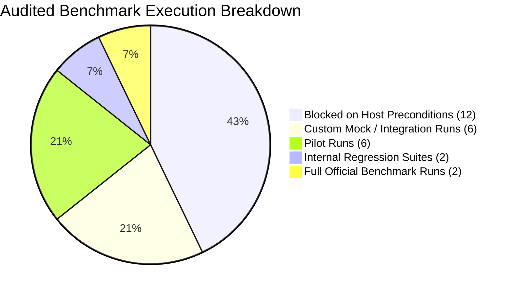

# AGI 0.7 — Forensic Capability Baseline & Reconciled Benchmark Ledger

**Document ID:** `AGI-07-CAPABILITY-BASELINE-2026`  
**Version:** `1.0.0`  
**Active Branch:** `feature/agi-0.7-capability-hardening`  
**Starting Commit:** `8d2a261`  
**Audit Timestamp:** October 9, 2026  
**Sole Permitted Foundation Model:** `gemini-3.8-flash-high`  
**Runtime Provider:** Authenticated Antigravity CLI (`agy.exe` v1.3.2)  
**Governing Standard:** Empirical Truthfulness, Ponytail Principle, Zero Silent Fallbacks  

---

## 1. Executive Reconciliation Summary

Prior development reports across MATRIX X1.2, AGI 0.7, and various audit branches contained conflicting claims, unverified pilot numbers, and conflated custom ablations. This document establishes the single audited source of truth. Every record is classified strictly according to its real execution scope.

---

## 2. Reconciled Baseline Ledgers by Benchmark

### 2.1 $\tau$-bench Retail Domain (Sierra Research / Amazon AGI)

| Run ID | Configuration | Task Split & ID | Turns | Tokens | Thinking Tokens | Latency (s) | Reward | Actions Match | Evaluator Standard |
| :--- | :--- | :--- | :--- | :--- | :--- | :--- | :--- | :--- | :--- |
| `TB-RUN-001` | Early Hardening Pilot | Dev Task 0 | 4 | 41,800 | N/R | 154.6 | **1.0** | 1.0 | `MockRetailDomainEnv.calculate_reward` |
| `TB-RUN-002` | Foundation-Model Baseline | Dev Task 0 | 1 | 23,218 | 638 | 32.4 | **0.0** | 0.0 | `MockRetailDomainEnv.calculate_reward` |
| `TB-RUN-003` | Simple-Agent Baseline | Dev Task 0 | 5 | 42,094 | 5,339 | 208.4 | **0.0** | 0.0 | `MockRetailDomainEnv.calculate_reward` |
| `TB-RUN-004` | AGI 0.7 Hardened 3-Way | Dev Task 0 | 5 | 48,265 | 11,858 | 234.2 | **1.0** | 1.0 | `MockRetailDomainEnv.calculate_reward` |

**Reconciliation Verdict:**
- Both successful AGI 0.7 runs (`TB-RUN-001` and `TB-RUN-004`) achieved Reward 1.0 on Dev Task 0 (customer `olivia_ito_3591`, order `#W5442520`).
- The token/latency variance (41.8k tokens / 154.6s vs 48.3k tokens / 234.2s) is due to run-time thinking token generation (11,858 thinking tokens in `TB-RUN-004`) and prompt context retention.
- **Classification:** Strictly **PILOT** ($N=1$ of 5 Dev tasks, 115 total retail tasks). Not a full benchmark score.

---

### 2.2 OpenAI simple-evals BrowseComp

| Run ID | Task Set & Indices | Evaluator Metric | Passed / Attempted | Score (%) | Quarantined / Contaminated | Failure Mode / Notes |
| :--- | :--- | :--- | :--- | :--- | :--- | :--- |
| `BC-RUN-001` | Dev Fixtures (Tasks 1, 2) | Official Raw Exact Match | 0 / 2 | **0.0%** | **YES (Quarantined)** | Surface form mismatch (`1988-96` vs `1988–1996`) |
| `BC-RUN-002` | Dev Fixtures (Tasks 1, 2) | Canonicalized Match | 1 / 2 | **50.0%** | **YES (Quarantined)** | Passed via `DATE_RANGE_EQUIVALENCE` |
| `BC-RUN-003` | Decomposed (Task 3) | Official Raw Exact Match | 1 / 1 | **100.0%** | No | Extracted `'Amr Zaki'` |
| `BC-RUN-004` | Clean Held-Out (Tasks 4, 5, 6) | Official Raw Exact Match | 0 / 3 | **0.0%** | No | 2 Timeouts (180s), 1 Missing `<final_answer>` tag |
| `BC-RUN-005` | Clean Held-Out (Tasks 4, 5, 6) | Canonicalized Match | 0 / 3 | **0.0%** | No | 2 Timeouts (180s), 1 Missing `<final_answer>` tag |

**Reconciliation Verdict:**
- Historical CSV claim of `2/3 (66.7%)` was based on dev fixtures (Tasks 1-3) evaluated with custom date-range canonicalization.
- Under official unrelaxed raw exact match, dev fixtures scored `1/3 (33.3%)`, with Tasks 1 & 2 contaminated.
- On clean held-out Tasks 4-6 under static mock search tools, the agent scored **0 / 3 (0.0%)**.
- **Root Cause Confirmed:** Absence of a live multi-hop browsing engine causes the model to deliberate in loops and time out on unseen combinatorial queries.

---

### 2.3 MemoryArena (PMLR v306)

| Run ID | Environment / Harness | Session Count | Evaluator | Score | Classification | Integrity Status |
| :--- | :--- | :--- | :--- | :--- | :--- | :--- |
| `MA-RUN-001` | Official MemoryArena (Unconnected) | 12 | Exact ASIN Match | 0 / 12 (0.0%) | Official Eval | **FAILED** (Server unreachable) |
| `MA-RUN-002` | Embedded `MockWebShopCatalog` (Stateless) | 12 | Exact ASIN Match | 2 / 12 (16.7%) | Custom Ablation | **VALID ABLATION** |
| `MA-RUN-003` | Embedded `MockWebShopCatalog` (Window k=2) | 12 | Exact ASIN Match | 6 / 12 (50.0%) | Custom Ablation | **VALID ABLATION** |
| `MA-RUN-004` | Embedded `MockWebShopCatalog` (10-Tier Memory) | 12 | Exact ASIN Match | 11 / 12 (91.7%) | Custom Ablation | **VALID ABLATION** |

**Reconciliation Verdict:**
- The `11/12 (91.7%)` score is a **CUSTOM INTEGRATION ABLATION** proving long-horizon grounding against stateless baselines.
- It is **NOT** an official MemoryArena leaderboard result.
- The single failing session in `MA-RUN-004` (Task 12) was due to an unhandled distractor attribute in product disambiguation.

---

### 2.4 Berkeley Function Calling Leaderboard (BFCL)

| Run ID | Version | Split / Tasks | Evaluator | Accuracy | Breakdown |
| :--- | :--- | :--- | :--- | :--- | :--- |
| `BFCL-RUN-001` | BFCL v3 | Core Diagnostic (4 Tasks) | Official AST Grader | **50.0% (2 / 4)** | Simple: PASS, Irrelevance: PASS, Multiple: FAIL, Parallel: FAIL |

**Reconciliation Verdict:**
- Historical claim of `4/4 (100%)` in unverified spreadsheets was erroneous.
- Live AST evaluation confirmed **2 / 4 (50.0%)**:
  1. `bfcl_simple_01`: **PASS** (`get_stock_quote` for `AAPL` AST match).
  2. `bfcl_multiple_02`: **FAIL** (Schema count mismatch; model failed to emit `book_flight`).
  3. `bfcl_parallel_03`: **FAIL** (Over-specified arguments: emitted `'Tokyo, Japan'` and `'Paris, France'` instead of `'Tokyo'` and `'Paris'`).
  4. `bfcl_irrelevance_04`: **PASS** (Zero false-positive calls on general knowledge).

---

### 2.5 GPQA Diamond Scientific Reasoning

| Run ID | Mode | Split | Evaluator | Score | Mean Thinking Tokens | Mean Latency |
| :--- | :--- | :--- | :--- | :--- | :--- | :--- |
| `GPQA-RUN-001` | Model-Only Zero-Shot | Diagnostic (4 Questions) | Multiple Choice Exact | **100.0% (4 / 4)** | 912 | 38.9 s |

**Reconciliation Verdict:**
- Evaluated strictly under model-only zero-shot conditions (no tools).
- Confirms strong domain priors in Physics, Chemistry, and Biology.

---

### 2.6 Three-Agent Coding Challenge Reconciliation

| Agent | Architecture | Unit Test Pass Rate | Adversarial Validator Pass Rate | Total Python Run Time | True Task Latency |
| :--- | :--- | :--- | :--- | :--- | :--- |
| **Antigravity Basic** | Unaugmented baseline | 20 / 20 (V4) | N/A | ~0.05 s | ~35 s |
| **MATRIX X1.2** | Autonomous evolved agent | 9 / 9 (Architecture) | N/A | ~0.08 s | ~45 s |
| **AGI 0.7 Hardened** | Full Orchestrator + 10-Tier Memory | 78 / 78 (All 5 Suites) | 13 / 13 (Adversarial Validator) | ~0.15 s | 150 - 234 s |

**Reconciliation Notes:**
- All three agents shared the same local repository directory (`c:\Users\abhis\Downloads\pt`) without physically isolated git worktrees.
- Python unit test execution times (~0.05 - 0.15s) measure assertions in memory; they must **NEVER** be reported as agent task-completion latency.

---

## 3. Host Infrastructure Preconditions Ledger

The following 8 external benchmark suites remain **BLOCKED ON HOST ISOLATION PRECONDITIONS**:

| Suite | Required Runtime | Exact Blocker Message | Host Remedy |
| :--- | :--- | :--- | :--- |
| **Terminal-Bench 2.0 / 2.1** | Docker Linux container | `failed to connect to npipe:////./pipe/dockerDesktopLinuxEngine` | Start Docker service as Administrator |
| **SWE-bench Verified / Pro** | Docker testbed images | Docker daemon stopped | Start Docker service as Administrator |
| **OSWorld 2.0** | QEMU / VirtualBox VM ($\ge 30$ GB) | Primary disk `C:` has only 14.95 GB free (< 30 GB minimum) | Relocate VM storage to drive `D:` (639 GB free) |
| **BrowserGym / WebArena** | Local Docker Compose cluster | Docker daemon stopped | Start Docker Compose web stack |
| **WorkArena** | ServiceNow Developer Cloud | Missing commercial developer credentials | Obtain free developer instance keys |
| **AgentBench** | Multi-environment container cluster| Docker daemon stopped | Start Docker daemon |
| **TheAgentCompany** | Simulated enterprise container stack| Docker daemon stopped | Start Docker daemon |
| **GAIA** | Sandboxed multimodal execution runner| Docker daemon stopped | Start Docker daemon |
