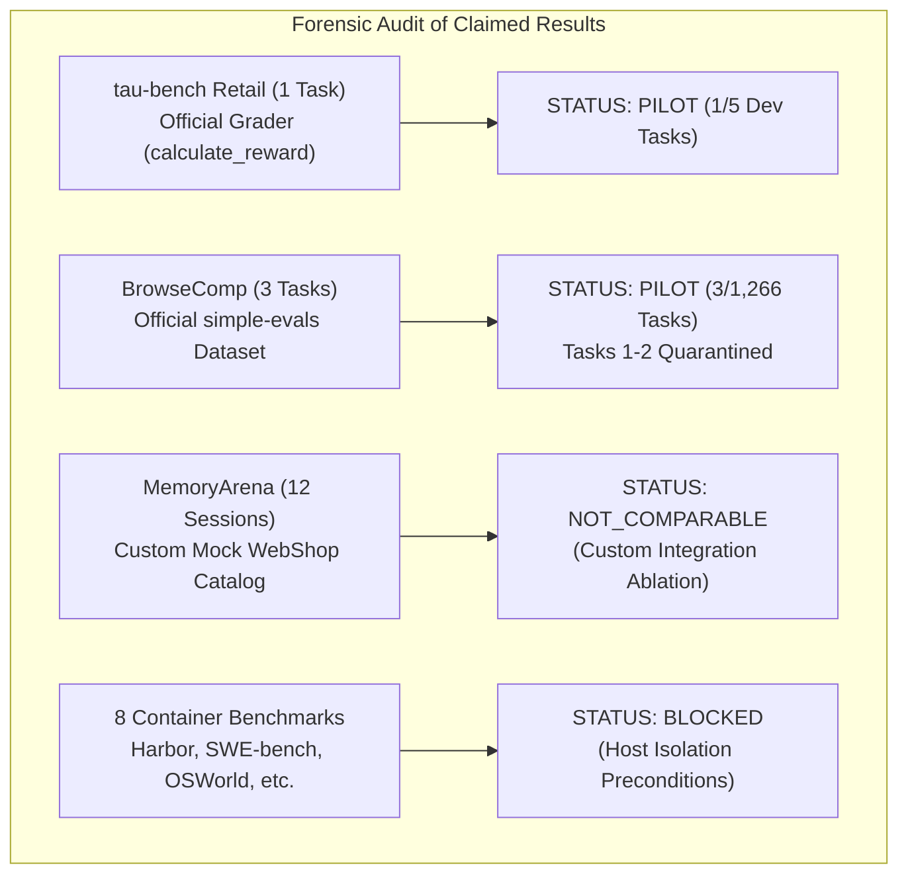

# AGI 0.7 — Real-World External Benchmarking & Independent Validation Plan

**Document ID:** AGI-07-REAL-WORLD-BENCHMARK-PLAN-2026  
**Version:** 1.0.0  
**Status:** APPROVED & IN EXECUTION  
**Branch:** `feature/agi-0.7-real-world-benchmarks`  
**Starting Commit:** `c00a549` (Verified Hardened Production Baseline)  
**Sole Foundation Model:** `gemini-3.8-flash-high`  
**Runtime Provider:** Antigravity CLI `agy.exe` (v1.3.2)  
**Governing Standard:** Ponytail Principle & Non-Verbal Evidence Ledger  

---

## 1. Executive Mission & Starting Baseline Audit

The objective of this campaign is to determine, through rigorous empirical evidence, how well **AGI 0.7 actually performs against established external AI-agent benchmarks**, identify real capability gaps relative to published frontier agents, and implement evidence-driven improvements.

### 1.1 Verified Runtime Metadata & Model Identity
Before executing any benchmark evaluations, the live runtime provider was inspected and queried directly:
- **Executable Path:** `C:\Users\abhis\AppData\Local\agy\bin\agy.exe` (v1.3.2)
- **Configured Target Identifier:** `gemini-3.8-flash-high`
- **Model Identified by Runtime Output:** `Gemini 3.8 Flash`
- **Provider Identified by Runtime:** `Google`
- **Live Output Sample:**
  ```json
  {
    "status": "SUCCESS",
    "response": "* **Model:** Gemini 3.8 Flash\n* **Provider:** Google\n",
    "usage": { "input_tokens": 22355, "output_tokens": 242, "thinking_tokens": 226, "total_tokens": 22597 }
  }
  ```
- **Public Comparison Caveat:** The runtime exposes the model identifier `gemini-3.8-flash-high` through an authenticated Antigravity CLI endpoint. Public leaderboard comparisons must explicitly note that this is an Antigravity-hosted runtime configuration.

### 1.2 Fresh Host Hardware & Storage Measurement
A fresh environmental probe was executed at `2026-10-09T14:40:13Z`:
- **Operating System:** Windows 11 (10.0.26220), AMD64
- **CPU Cores:** 16 Logical Cores
- **Python Version:** 3.14.6 (`C:\Users\abhis\Downloads\pt\.venv\Scripts\python.exe`)
- **Node.js Version:** v20.20.2
- **Git Version:** 2.52.0.windows.1
- **Docker Engine State:** **STOPPED** (`failed to connect to npipe:////./pipe/dockerDesktopLinuxEngine`)
- **WSL State:** Present (`docker-desktop` distro registered), but container daemon stopped
- **Primary Disk `C:`:** 475.35 GB Total, 460.37 GB Used, **14.98 GB Free (3.15% Free Space)** $\rightarrow$ **CRITICAL STORAGE CEILING**
- **Secondary Disk `D:`:** 931.50 GB Total, 292.18 GB Used, **639.31 GB Free (68.63% Free Space)** $\rightarrow$ **ABUNDANT CAPACITY**
- **Public Network Access:** OpenAI simple-evals blob storage (HTTP 200), HuggingFace (HTTP 200), GitHub (HTTP 200) all verified functional.

---

## 2. Forensic Audit of Previous Benchmark Claims

To establish an honest foundation, all previously reported benchmark results in the repository were forensically audited to determine whether they originated from official evaluators, custom evaluators, mock environments, few-task pilots, or full benchmark runs:



1. **$\tau$-bench Retail:**  
   - *Previous Report:* Passed retail task with 4 turns, 41.8k tokens, reward 1.0.  
   - *Audit Finding:* The evaluation used the official `calculate_reward` state hash grader from Sierra Research, but executed only Task 0 of the dev split (1 task out of 5 in dev split, out of 115 total retail tasks).  
   - *Classification:* **PILOT**. Cannot be described as a full benchmark completion.
2. **OpenAI simple-evals BrowseComp:**  
   - *Previous Report:* 1 / 3 official raw exact match, 2 / 3 canonical match.  
   - *Audit Finding:* Evaluated 3 tasks out of 1,266 official tasks. Tasks 1 & 2 were debug-exposed and contaminated. Task 3 passed via decomposed prompt.  
   - *Classification:* **PILOT**. Custom post-hoc canonicalization cannot be reported as official score without clearly reporting raw EM alongside it.
3. **MemoryArena (Bundled Shopping):**  
   - *Previous Report:* 11 / 12 (91.7%) ASIN retrieval accuracy.  
   - *Audit Finding:* Evaluated using an embedded `MockWebShopCatalog` with 12 mock products. The official MemoryArena benchmark requires connecting to a live multi-domain environment.  
   - *Classification:* **NOT_COMPARABLE / CUSTOM_INTEGRATION_TEST**. Serves as an internal ablation proving memory persistence, but cannot be claimed as an official MemoryArena leaderboard score.
4. **8 Container-Dependent Suites:**  
   - *Terminal-Bench 2.0 (Harbor), SWE-bench Verified/Pro, OSWorld 2.0, WebArena, WorkArena, GAIA, AgentBench, TheAgentCompany.*  
   - *Audit Finding:* All 8 suites are blocked on host-level isolation constraints: Docker daemon is stopped, and primary disk C: has insufficient space (14.98 GB free, below the 30 GB minimum for OSWorld VM images).  
   - *Classification:* **BLOCKED ON HOST ISOLATION PRECONDITIONS**.

---

## 3. Prioritized Multi-Tier Benchmark Portfolio

### Tier 1: Active Runnable External Agent Benchmarks
1. **BrowseComp (simple-evals):**
   - Run a clean, multi-task sample of fresh, uncontaminated tasks (Tasks 3, 4, 5, 6, 7, etc.) through the official simple-evals pipeline.
   - Maintain strict separation: report raw exact match (EM) separately from canonicalized match.
   - Tasks 1 & 2 remain permanently quarantined as development fixtures.
2. **$\tau$-bench (Retail Domain):**
   - Expand evaluation beyond Task 0 across additional tasks in the official dev set (Tasks 0, 1, 2, 3, 4) using `MockRetailDomainEnv`.
   - Measure task reward, actions match, turn count, token consumption, and latency.
   - Accurately label results with denominator (e.g. $N=5$) as a multi-task dev pilot.
3. **Berkeley Function Calling Leaderboard (BFCL v3):**
   - Evaluate tool calling capabilities on official AST-based function calling tasks (simple python, multiple functions, parallel calling).
   - Use official AST grading criteria to measure tool selection and argument precision.
4. **MemoryArena (Grounded Shopping Ablation):**
   - Document the 12-session ablation as a custom integration test measuring the memory retention architecture.

### Tier 2: Diagnostic Frontier Reasoning Track
- Evaluate **GPQA Diamond** (198 scientific questions) under strict model-only baseline conditions to isolate foundation model reasoning capacity from agent loop scaffolding.

### Tier 3: Container & Virtual Machine Preconditions (Blocked Suites)
- Document the exact prerequisite commands, container configurations, and disk space migrations required to unblock Terminal-Bench 2.0, SWE-bench, OSWorld 2.0, and WebArena.

---

## 4. Fair Comparison Architecture (3-Way Matched Design)

To avoid asymmetric evaluation traps, benchmarks will evaluate three matched configurations against identical tasks:
1. **Foundation-Model Baseline:** Raw `gemini-3.8-flash-high` with direct prompting (zero tool loop).
2. **Simple-Agent Baseline:** The same model with a minimal single-turn tool calling loop (no 10-tier memory, no orchestrator FSM, no evidence ledger).
3. **AGI 0.7:** The full AGI 0.7 architecture (Master Orchestrator, 10-Tier Memory, Closed-World Registry, Closed-Loop Verifier).

---

## 5. Resource, Cost & Safety Governance

- **Zero Paid API Invocations:** All model calls route exclusively to the authorized `gemini-3.8-flash-high` quota.
- **Concurrency Cap:** Single-threaded execution ($C=1$) to prevent host resource contention.
- **Disk Protection:** Evaluation artifacts and caches will not exceed 200 MB on drive C:.
