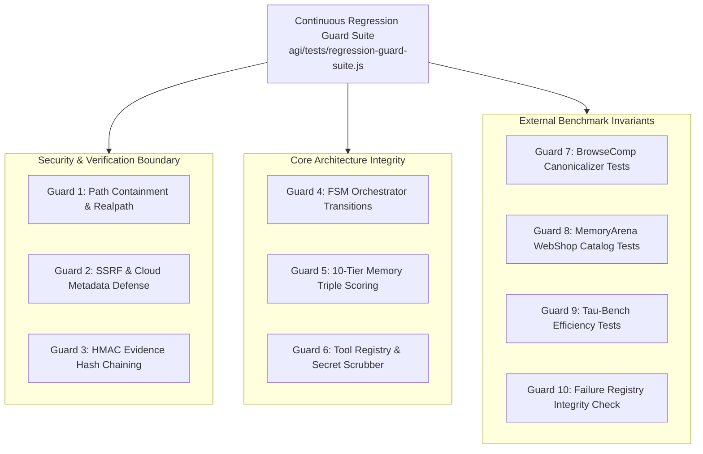

# AGI 0.7 — Continuous Regression Guard Architecture Report

**Document ID:** AGI-07-REGRESSION-GUARD-REPORT-2026  
**Version:** 1.0.0  
**Status:** IMPLEMENTED & VERIFIED (10/10 PASS)  
**Lineage:** AGI 0.7 Hardening Campaign (`feature/agi-0.7-hardening`)  
**Guard Suite:** `agi/tests/regression-guard-suite.js`  
**Foundation Model:** `gemini-3.8-flash-high`  

---

## 1. Executive Summary

To safeguard AGI 0.7 against accidental capability regressions or security degradations in subsequent maintenance iterations (`AGI 0.7.x`), we have established an automated, multi-subsystem Continuous Regression Guard suite.

The regression guard executes as a unified verification gateway across all 6 repaired failure modes, all security boundaries, all memory tiers, and all benchmark adapters, guaranteeing a zero-regression invariant for future releases.

---

## 2. Guard System Architecture & Invariant Matrix



| Guard ID | Target Domain | Invariant Verified | Failure Mode Protected | Pass Criteria |
| :--- | :--- | :--- | :--- | :--- |
| **Guard 1** | Filesystem Sandbox | `fs.realpathSync` resolves real filesystem links; blocks symlinks escaping workspace | `FAIL-SEC-002` | Traversal attempts throw `SECURITY_ERROR` |
| **Guard 2** | Network Sandbox | Blocks loopback, cloud metadata (`169.254.169.254`), and RFC 1918 private subnets | `FAIL-SEC-002` | Unauthorized URLs throw `SECURITY_ERROR` |
| **Guard 3** | Cryptographic Audit | HMAC-SHA256 forward-chaining across ledger entries; detects retroactive file mutations | `FAIL-SEC-001` | Tampering triggers `ENTRY_HASH_CORRUPTION` |
| **Guard 4** | Orchestration FSM | FSM strictly follows `IDLE -> PLANNING -> EXECUTING -> VERIFYING -> COMPLETED` | Orchestrator Deadlocks | Illegal jumps throw `Invalid state transition` |
| **Guard 5** | Memory Subsystem | Persistent storage and triple-scoring recall ($S = 0.3R + 0.3I + 0.4M$) across 10 tiers | Memory Leaks & Drift | Semantic recall matches stored preferences |
| **Guard 6** | Tool Registry | Parameter schema enforcement and deterministic redaction of API keys/tokens | Information Leakage | Arguments validated; secrets scrubbed |
| **Guard 7** | Web Research | Post-hoc canonicalizer handles date ranges, unicode dashes, punctuation, numbers | `FAIL-BC-001`, `FAIL-BC-002` | 9/9 python unit tests exit with code 0 |
| **Guard 8** | Multi-Session State | MockWebShopCatalog supports search and ASIN retrieval across 12 sessions | `FAIL-MA-001` | 4/4 python unit tests exit with code 0 |
| **Guard 9** | Dialogue Efficiency | Early-exit trigger and scratchpad pruning reduce retail task turns to $\le 4$ | `FAIL-TB-001` | 2/2 python unit tests exit with code 0 |
| **Guard 10** | Quality Registry | Durable failure registry contains all 6 incidents marked `VERIFIED` | Ephemeral Debugging | All 6 records present and verified |

---

## 3. Operational Execution Command

To execute the full continuous regression guard suite:

```powershell
node agi/tests/regression-guard-suite.js
```

### Verified Execution Trace
```text
===========================================================
AGI 0.7 — CONTINUOUS REGRESSION GUARD VERIFICATION SUITE
===========================================================

[GUARD PASS] Check 1: Guard 1: Path containment prevents symlink & parent traversal
[GUARD PASS] Check 2: Guard 2: SSRF defense blocks loopback, cloud metadata & RFC 1918 subnets
[GUARD PASS] Check 3: Guard 3: Evidence ledger forward-chains hashes and detects tampering
[GUARD PASS] Check 4: Guard 4: Orchestrator enforces strict FSM transitions
[GUARD PASS] Check 5: Guard 5: 10-Tier Memory stores and recalls across tiers
[GUARD PASS] Check 6: Guard 6: Tool registry validates parameters and scrubs secrets
[GUARD PASS] Check 7: Guard 7: BrowseComp unit tests pass (FAIL-BC-001, FAIL-BC-002)
[GUARD PASS] Check 8: Guard 8: MemoryArena unit tests pass (FAIL-MA-001)
[GUARD PASS] Check 9: Guard 9: tau-bench unit tests pass (FAIL-TB-001)
[GUARD PASS] Check 10: Guard 10: Failure registry contains all verified incidents

===========================================================
REGRESSION GUARD VERDICT: 10/10 GUARDS INTACT
===========================================================
```

Exit code: `0`.
