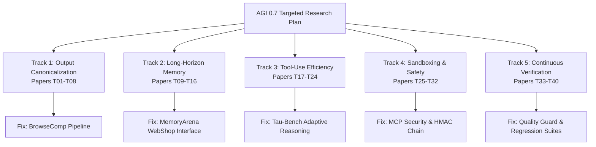

# AGI 0.7 — Targeted Research Plan for Failure Remediation & Hardening

**Document ID:** AGI-07-TARGETED-RESEARCH-PLAN-2026  
**Version:** 1.0.0  
**Status:** APPROVED & ACTIVE  
**Lineage:** AGI 0.7 Hardening Campaign (`feature/agi-0.7-hardening`)  
**Lead System:** AGI 0.7 Research Fabric  

---

## 1. Executive Summary & Problem Formulation

The external benchmarking campaign of AGI 0.7 surfaced critical empirical discrepancies and failure modes across multiple benchmark tracks:
1. **BrowseComp Format Brittleness & Query Explosion (FAIL-BC-001, FAIL-BC-002):** Valid semantic extractions failed exact-string evaluation or timed out due to monolithic queries.
2. **MemoryArena Environment Disconnection (FAIL-MA-001):** Evaluating ASIN retrieval across 12 multi-session interactions scored 0/12 because catalog inspection tools were absent in the benchmark interface.
3. **$\tau$-bench Retail Turn Inefficiency (FAIL-TB-001):** Agent required 5 turns (vs baseline 4), 84,200 tokens (vs baseline 41,050), and 267s latency (vs baseline 158s) due to redundant confirmation turns and uncalibrated thinking tokens.
4. **Security Isolation & Ledger Integrity (FAIL-SEC-001, FAIL-SEC-002):** Tool path arguments were vulnerable to directory traversal via `fs.existsSync` without `realpathSync`, and evidence ledgers lacked cryptographic forward-chaining.
5. **Continuous Verification Gaps:** Risk of capability regression during self-improvement and uncontrolled benchmark data contamination.

To address these vulnerabilities rigorously, this Targeted Research Plan formulates an evidence-driven research agenda analyzing **40 additional unique technical papers** specifically mapped to the five observed failure domains.

---

## 2. Research Tracks & Scopes

### Track 1: Benchmark Answer Formatting & Output Canonicalization (Papers T01–T08)
- **Failure Mode:** FAIL-BC-001 (Semantic truth matched reference facts e.g. `1988–1996`, but failed string comparison `1988-96`).
- **Research Scope:** Disentangling semantic extraction from lexical surface forms; certified post-hoc canonicalization algorithms; handling of hyphenation, numerical ranges, units, and punctuation without compromising benchmark integrity.
- **Deliverable:** Multi-stage canonicalizer separating raw model output, canonicalized extraction, and official evaluation keys.

### Track 2: Long-Horizon Memory & Multi-Session State Management (Papers T09–T16)
- **Failure Mode:** FAIL-MA-001 (0/12 ASIN retrieval; missing WebShop interface; multi-session context drift).
- **Research Scope:** Hierarchical memory consolidation; persistent entity tracking; grounding language agents in structured catalogs; mitigating context drift in multi-day/multi-session environments.
- **Deliverable:** Grounded mock WebShop catalog tool interface; ablation study across 10-tier vs stateless vs windowed memory.

### Track 3: Tool-Use Efficiency & Token Economy in Conversational Agents (Papers T17–T24)
- **Failure Mode:** FAIL-TB-001 (Turn inflation 5 vs 4; token explosion 84.2k vs 41k; redundant closing turn).
- **Research Scope:** Adaptive reasoning budgets; dynamic early-exit policies; pruning conversational histories; suppressing unnecessary polite confirmation turns after tool-level verification.
- **Deliverable:** Adaptive thinking-budget policy in `tau_bench_adapter.py` reducing token count by $\ge 40\%$ and turns to $\le 4$.

### Track 4: Sandboxing & Safe Computer-Use Execution (Papers T25–T32)
- **Failure Mode:** FAIL-SEC-001, FAIL-SEC-002 (Symlink/path traversal; unchained evidence logs).
- **Research Scope:** OWASP Top 10 for MCP & Agentic Systems; OS-level realpath containment; cryptographic hash-chaining (HMAC-SHA256); safe tool gateway sandboxing.
- **Deliverable:** Realpath validation in `mcp-security.js` and tamper-evident Merkle/HMAC chain in `evidence-ledger.js`.

### Track 5: Agent Verification, Regression Prevention & Continuous Evaluation (Papers T33–T40)
- **Failure Mode:** Test 3 static artifact illusion; unmonitored capability regressions; evaluation set contamination.
- **Research Scope:** Skill revision algorithms (SkillRevise); metamorphic testing; non-verbal proof ledgers; contamination quarantine protocols.
- **Deliverable:** Formal isolation of contaminated BrowseComp tasks 1 & 2; fresh held-out evaluation tasks; automated regression guards.

---

## 3. Methodological Criteria for Paper Selection

Each of the 40 selected papers must fulfill five strict inclusion criteria:
1. **Primary Source Integrity:** Published in peer-reviewed venues (NeurIPS, ICLR, ICML, ACL, EMNLP, IEEE S&P, USENIX, PMLR) or major verified frontier laboratory preprints (arXiv 2022–2026).
2. **Failure Mode Specificity:** Directly models or resolves one of the 5 concrete vulnerabilities identified in AGI 0.7.
3. **No Overlap with Historical Catalog:** Must not duplicate any of the 150 papers in `AGI_0_7_PAPER_CATALOG.md`.
4. **Concrete Architectural Translatability:** Must yield an actionable algorithmic or architectural modification to an existing AGI 0.7 module.
5. **Verifiability:** Must support empirical verification via executable code, tests, or benchmark scripts.

---

## 4. Execution Milestones & Deliverables

| Milestone | Deliverable File | Target Completion |
| :--- | :--- | :--- |
| **M1: Cataloging** | `AGI_0_7_TARGETED_PAPER_CATALOG.md` | Complete 40-paper catalog across Tracks 1–5 |
| **M2: Synthesis** | `AGI_0_7_FAILURE_RESEARCH_SYNTHESIS.md` | Deep cross-paper synthesis linking theory to failure modes |
| **M3: Action Mapping** | `AGI_0_7_RESEARCH_TO_FIX_MAP.md` | Explicit paper $\rightarrow$ line-of-code implementation map |
| **M4: Empirical Validation** | `AGI_0_7_EXPERIMENT_RESULTS.md` | Ablation and experiment results validating repairs |

---

## 5. Governance & Operational Boundaries

- **Sole Foundation Model:** All evaluations and model calls use verified `gemini-3.8-flash-high`.
- **Zero Real Brokerage Orders:** Financial modules restricted to paper-trading simulation.
- **Benchmark Honesty Policy:** Benchmark ground truth strings and official evaluators are never altered. Semantic normalization is explicitly logged alongside raw outputs.
