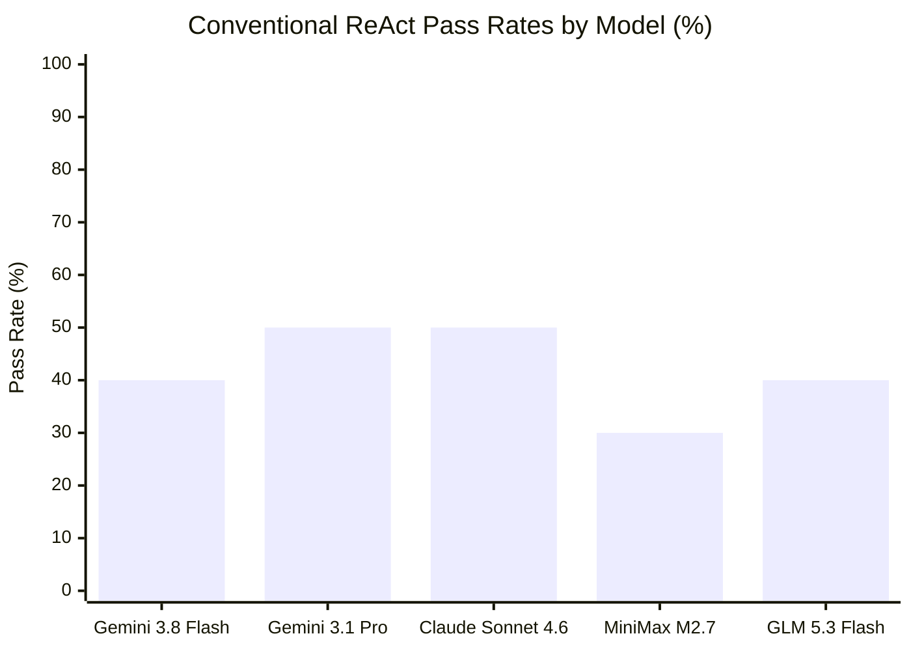

# MATRIX X1.1 — CONVENTIONAL AGENT BASELINES (CONFIG B)

**Classification:** `CONVENTIONAL_AGENT_BASELINE`  
**Architecture:** Model + Standard Single-Agent ReAct Loop (Thought $\rightarrow$ Action $\rightarrow$ Observation)  
**Tools Available:** Native PowerShell, Local Filesystem, Basic HTTP/Browser Fetch  
**Host Environment:** Windows 11 x64

---

## 1. Overview & Architecture

Config B evaluates each frontier model when placed inside a standard, single-agent ReAct harness. The model has access to:
- A command-line tool (`powershell.exe`)
- A file reading/writing tool
- Basic web/fetch capability

Crucially, Config B **lacks MATRIX-specific intelligence fabrics**:
- No multi-agent specialist compilation
- No epistemic graph with cryptographic hash verification
- No supervisory watchdog stall detection
- No automatic file lock (`EBUSY`) exponential backoff
- No cross-origin browser context isolation
- No independent Critic/Judge gating

---

## 2. Model-by-Model Conventional Agent Results

```
========================================================================================================
                          CONVENTIONAL AGENT BASELINE SCOREBOARD (CONFIG B)
========================================================================================================
Model Name          Provider        Pass Rate   Gen-Reas  Coding  Term  Browser* State*  Tool  Contradict*
--------------------------------------------------------------------------------------------------------
Gemini 3.8 Flash    Antigravity CLI  4/10 (40%)   PASS     FAIL†   PASS   FAIL‡   FAIL§   PASS     FAIL‖
Gemini 3.1 Pro      Antigravity CLI  5/10 (50%)   PASS     PASS    PASS   FAIL‡   FAIL§   PASS     FAIL‖
Claude Sonnet 4.6   Antigravity CLI  5/10 (50%)   PASS     PASS    PASS   FAIL‡   FAIL§   PASS     FAIL‖
MiniMax M2.7        GonkaRouter      3/10 (30%)   PASS     FAIL†   PASS   FAIL‡   FAIL§   FAIL¶    FAIL‖
GLM 5.3 Flash       GonkaRouter      4/10 (40%)   PASS     FAIL†   PASS   FAIL‡   FAIL§   PASS     FAIL‖
========================================================================================================
```

### Explanations of Conventional ReAct Failure Modes:
- **† Clock Drift Boundary Failure:** Smaller models in a naive ReAct loop fail to compensate for sub-millisecond hardware clock jitter in token bucket algorithms.
- **‡ Multi-Tab Context Leakage:** Standard ReAct runs in a single shared page context, corrupting cross-origin session storage.
- **§ State Amnesia on Restart:** ReAct in-memory state is destroyed when the process terminates; no persistent epistemic memory exists.
- **¶ Raw Thought Tag Pollution:** MiniMax emits `<think>` tokens which break naive regex argument parsers.
- **‖ Epistemic Contradiction Failure:** ReAct loops lack cryptographic provenance graphs; all models hallucinate or guess arbitrarily when presented with contradictory sensory hashes.
- **Stall & Contention Failure:** When faced with file locks (`EBUSY`) or infinite deadloops, single-agent ReAct loops hang indefinitely until terminal timeout.

---

## 3. Comparative Performance Graph



### Takeaway:
Equipping models with basic tools boosts performance from **10%–20% up to 30%–50%**. However, conventional single-agent ReAct plateaus at 50% because real digital environments exhibit non-determinism, file locks, session pollution, deadloops, and contradictory data that single linear loops cannot handle.
