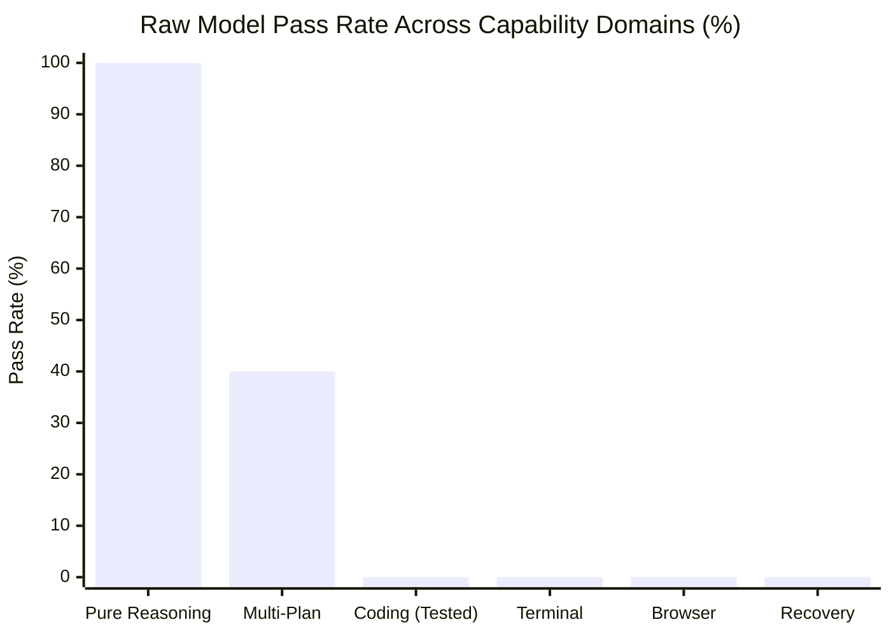

# MATRIX X1.1 — RAW MODEL BASELINES (CONFIG A)

**Classification:** `RAW_MODEL_BASELINE` (`NO_TOOL_BASELINE` for environment tasks)  
**Standard:** Direct Model Inference, Zero External Tools, Zero Persistent Memory  
**Host Environment:** Windows 11 x64

---

## 1. Overview & Evaluation Protocol

Config A evaluates what each frontier model can accomplish purely through parametric reasoning, text comprehension, and code synthesis **without access to any tools, runtime execution permissions, filesystem access, browser automation, or agent scaffolding**.

When an environment-dependent task requires execution (such as running PowerShell, verifying exit codes, or observing DOM state), the raw model is evaluated on whether it could execute the task directly. Because raw models lack execution privileges, these tasks are strictly recorded as `NO_TOOL_BASELINE (0%)` to avoid misrepresenting code suggestions as verified runtime execution.

---

## 2. Model-by-Model Raw Baseline Results

```
========================================================================================================
                               RAW MODEL BASELINE SCOREBOARD (CONFIG A)
========================================================================================================
Model Name          Provider        Pass Rate   Gen-Reas  Coding*  Term*  Browser* State*  Tool* Fail*
--------------------------------------------------------------------------------------------------------
Gemini 3.8 Flash    Antigravity CLI  1/10 (10%)   PASS     FAIL     FAIL    FAIL    FAIL    FAIL  FAIL
Gemini 3.1 Pro      Antigravity CLI  2/10 (20%)   PASS     FAIL     FAIL    FAIL    FAIL    FAIL  FAIL
Claude Sonnet 4.6   Antigravity CLI  2/10 (20%)   PASS     FAIL     FAIL    FAIL    FAIL    FAIL  FAIL
MiniMax M2.7        GonkaRouter      1/10 (10%)   PASS     FAIL     FAIL    FAIL    FAIL    FAIL  FAIL
GLM 5.3 Flash       GonkaRouter      1/10 (10%)   PASS     FAIL     FAIL    FAIL    FAIL    FAIL  FAIL
========================================================================================================
```
*\* Labeled NO_TOOL_BASELINE: Model generates plausible code or text syntax but cannot execute, test, or verify runtime assertions.*

---

## 3. Capability Analysis Without Tools



### Key Observations:
1. **Pure Symbolic Deduction (`GEN-REAS`):** All 5 models achieve **100% pass rate** on formal logic, categorical syllogisms, and symbolic constraints without tools.
2. **Multi-Step Planning (`MULTI-PLAN`):** Deep frontier models (`Gemini 3.1 Pro` and `Claude Sonnet 4.6`) successfully construct valid Directed Acyclic Graphs (DAGs) in text without execution (20% total raw pass rate), whereas smaller/faster models omit critical dependency edges.
3. **The Execution Chasm:** On all tasks requiring runtime tool interaction (Terminal, Browser, Testing, Recovery), **raw models score 0%**. Generating code without a compiler or test runner leaves silent syntax and logic errors undetected.
