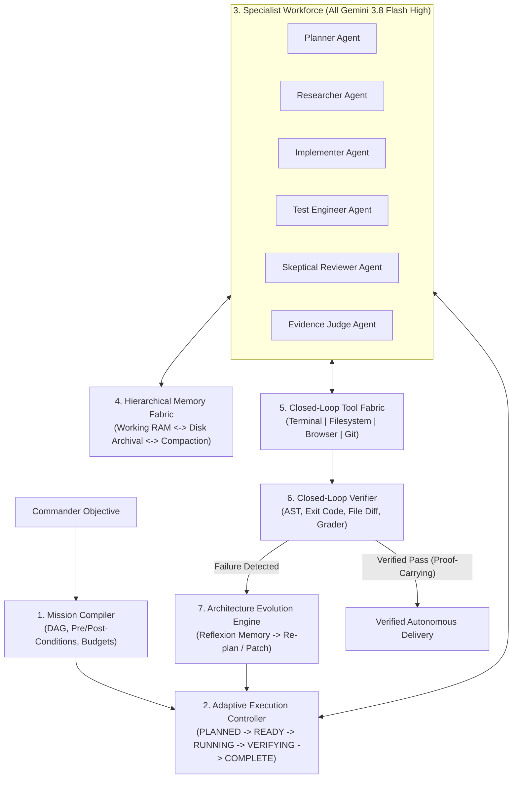

# MATRIX X1.2 — ARCHITECTURE DESIGN SPECIFICATION
## Single-Model Frontier Agent Architecture Powered Exclusively by Gemini 3.8 Flash High

**Specification Identifier:** `ARCH-SPEC-X1.2-20261009`  
**Target System:** MATRIX X1.2  
**Sole Foundation Model:** Gemini 3.8 Flash High (`gemini-3.8-flash-high`)  
**Design Philosophy:** "Less code, zero bloat, rigorous verification, closed-loop control." (Ponytail Principle)

---

## 1. System Architecture Overview

MATRIX X1.2 coordinates 7 core subsystems arranged in an autonomous closed-loop control fabric:

---

## 2. Detailed Subsystem Specifications

### Subsystem A: Mission Compiler (`matrix/missions/mission-compiler.js`)
- **Responsibility:** Compiles user intent into an executable Directed Acyclic Graph (DAG) of discrete work units.
- **Contract:**
  - `compile(objective, constraints)`: Returns `{ id, nodes: [ { id, dependencies, goal, successCondition, budget } ], edges: [...] }`.
  - Distinguishes planning completion from verified execution completion.
  - Generates rollback checkpoints for each critical node.

### Subsystem B: Adaptive Execution Controller (`matrix/cognition/adaptive-execution-controller.js`)
- **Responsibility:** Executes mission DAG nodes through a deterministic finite state machine.
- **Lifecycle States:** `PLANNED` $\rightarrow$ `READY` $\rightarrow$ `RUNNING` $\rightarrow$ `VERIFYING` $\rightarrow$ `COMPLETE`.
- **Failure States:** `RETRYABLE_FAILURE`, `BLOCKED`, `TIMED_OUT`, `CANCELLED`, `TERMINAL_FAILURE`.
- **Deadlock Watchdog:** Identifies repetitive identical tool invocations ($N \ge 2$) and interrupts execution, escalating to diagnostic re-planning.

### Subsystem C: Specialist Workforce Using One Model (`matrix/agents/specialist-workforce.js`)
- **Responsibility:** Implements role differentiation without multi-model divergence.
- **Strict Invariance:** Every reasoning role is bound exclusively to `gemini-3.8-flash-high` with 120s timeout.
- **Specialized Roles:**
  1. **Planner:** Decomposes objectives into milestone DAGs.
  2. **Researcher:** Finds documentation and verifies API contracts.
  3. **Implementer:** Writes minimal, precise, non-bloated code.
  4. **Test Engineer:** Creates runnable test files asserting acceptance criteria.
  5. **Skeptical Reviewer:** Audits code against safety, bloat, and regression risks.
  6. **Evidence Judge:** Issues final pass/fail arbitration based on test execution.
  7. **Resource Controller:** Monitored token and time budgets.

### Subsystem D: Hierarchical Memory Fabric (`matrix/memory/memory-fabric.js`)
- **Responsibility:** Prevents context saturation and preserves cross-session learnings.
- **Tiers:**
  - **Tier 1 (Working Memory):** Active turn dialogue, compacted to $< 35,000$ tokens.
  - **Tier 2 (Episodic Disk Archive):** Full raw tool outputs and terminal logs indexed by cryptographic hash.
  - **Tier 3 (Semantic & Verified Facts):** SHA-256 backed knowledge nodes with explicit source provenance.
  - **Tier 4 (Failure Memory):** Negative examples preventing strategy recurrence.

### Subsystem E: Closed-Loop Tool Execution Fabric (`matrix/tools/tool-router.js`)
- **Responsibility:** Mediates host operations through structured, sandboxed interfaces.
- **Guarantees:**
  - Native argument arrays (no shell string interpolation).
  - Explicit stdout/stderr byte limits.
  - Secret scrubbing on all inputs and outputs.
  - Permission verification for destructive commands.

### Subsystem F: Evidence & Closed-Loop Verification Engine (`matrix/verification/closed-loop-verifier.js`)
- **Responsibility:** Independent verification of real-world state changes.
- **Non-Verbal Verifications:**
  - File modification: Checks file exists, modified timestamp changed, SHA-256 differs from baseline.
  - Code syntax: Runs `node --check` to verify syntax before execution.
  - Test validation: Spawns independent test runner and verifies exit code 0.
  - Grader compliance: Executes official benchmark evaluation functions.

### Subsystem G: Architecture Evolution Engine (`matrix/learning/architecture-evolution.js`)
- **Responsibility:** Governed autonomous self-improvement.
- **Protocol:**
  - Diagnoses bottlenecks $\rightarrow$ Proposes targeted change $\rightarrow$ Implements on isolated branch $\rightarrow$ Runs 16-gate regression $\rightarrow$ Measures token/latency delta $\rightarrow$ Promotes only if Pareto-superior.
  - Boundaries: V4 baseline, security kernel, and commander approval ladder are permanently locked.
