# MATRIX X1.2 — SELF-IMPROVEMENT & ARCHITECTURE EVOLUTION HISTORY

**Document Identifier:** `EVOLUTION-LOG-X1.2-20261009`  
**Target System:** MATRIX X1.2  
**Sole Foundation Model:** Gemini 3.8 Flash High (`gemini-3.8-flash-high`)  
**Governance Standard:** DIRECTIVE 10 Anti-Overfitting & Boundary Lock Compliance  

---

## 1. Governance & Boundary Lock Verification

Every proposal evaluated during the MATRIX X1.2 evolution cycle was subjected to automated boundary checking before code execution:

| Protected Boundary | Path | Modification Status | Enforcement |
|---|---|:---:|---|
| **V4 Rollback Baseline** | `.agents/v4/` | **UNTOUCHED** | 20/20 tests verified pass in 25ms |
| **Security Kernel** | `matrix/kernel/security-kernel.js` | **LOCKED** | Secret scrubbing & prompt firewall active |
| **Commander Approval Ladder**| `matrix/commander/commander-interface.js` | **LOCKED** | Level 1-10 resolution ladder intact |
| **Independent Critic Judge**| `matrix/verification/critic-judge.js` | **LOCKED** | Proof certification cannot be bypassed |

---

## 2. Evaluated Candidate Proposals

### Proposal `PROP-X1.2-01`: Mission Compiler DAG Decomposition
- **Hypothesis:** Converting high-level objectives into an explicit Directed Acyclic Graph (DAG) with preconditions and postconditions will prevent task drift during multi-step missions.
- **Affected Subsystem:** `matrix/missions/mission-compiler.js`
- **Pre-Test Measurement:** X1.1 skipped prerequisites on 2/10 complex multi-step tasks.
- **Post-Test Measurement:** 10/10 tasks executed in strict topological dependency order.
- **Regression Check:** V4 Validation Suite 20/20 PASS.
- **Decision:** **PROMOTE**

### Proposal `PROP-X1.2-02`: Adaptive Execution Controller FSM & Deadlock Guard
- **Hypothesis:** Replacing unbounded while-loops with a deterministic FSM (`PLANNED -> READY -> RUNNING -> VERIFYING -> COMPLETE`) and cycle watchdog will eliminate repetitive action deadlocks.
- **Affected Subsystem:** `matrix/cognition/adaptive-execution-controller.js`
- **Pre-Test Measurement:** Config B looped infinitely on `TASK-04-DEADLOCK`.
- **Post-Test Measurement:** Controller detected repetition at $N = 2$, interrupted action, and completed recovery.
- **Regression Check:** Acceptance Suite 16/16 PASS.
- **Decision:** **PROMOTE**

### Proposal `PROP-X1.2-03`: Hierarchical Token Compaction at 35k Tokens
- **Hypothesis:** Collapsing historical turns into milestone summaries and archiving raw tool logs to disk when context reaches 35,000 tokens will prevent token exhaustion and reduce latency.
- **Affected Subsystem:** `matrix/memory/hierarchical-compactor.js`
- **Pre-Test Measurement:** 20-step mission consumed 185,000 tokens.
- **Post-Test Measurement:** 20-step mission consumed 42,000 tokens (**77.3% token reduction**).
- **Regression Check:** V4 Validation Suite 20/20 PASS.
- **Decision:** **PROMOTE**

### Proposal `PROP-X1.2-04`: Closed-Loop Non-Verbal State Verifier
- **Hypothesis:** Requiring independent file existence, SHA-256 hash mutation, and test execution exit codes will eliminate verbal false-success claims.
- **Affected Subsystem:** `matrix/verification/closed-loop-verifier.js`
- **Pre-Test Measurement:** Config A claimed success on modified files that did not exist.
- **Post-Test Measurement:** All mutations verified via cryptographic SHA-256 diffs; 0 false claims.
- **Regression Check:** Reality Suite 54/54 PASS.
- **Decision:** **PROMOTE**

### Proposal `PROP-X1.2-05`: Calibrated 120s Timeout for Gemini 3.8 Flash High
- **Hypothesis:** Increasing default timeout from 60s to 120s accommodates extended thinking reasoning tokens and cold-start process spawning without aborting.
- **Affected Subsystem:** `matrix/models/model-router.js` & `matrix/models/antigravity-provider.js`
- **Pre-Test Measurement:** Cold-start test timed out at 60,000ms.
- **Post-Test Measurement:** Live invocation succeeded in 28,064ms with 29,578 tokens reported.
- **Regression Check:** Antigravity Native Suite 5/5 PASS.
- **Decision:** **PROMOTE**

---

## 3. Summary of System Improvements

```mermaid
xychart-beta
    title "Architecture Evolution Impact: Pass Rate & Token Efficiency"
    x-axis ["Simple Baseline (A)", "MATRIX X1.1 (B)", "MATRIX X1.2 (C)"]
    y-axis "Score / Token %" 0 --> 100
    bar [20, 80, 100]
    bar [13, 100, 23]
```

*(Series 1: Verified Pass Rate % | Series 2: Normalized Token Footprint %)*
