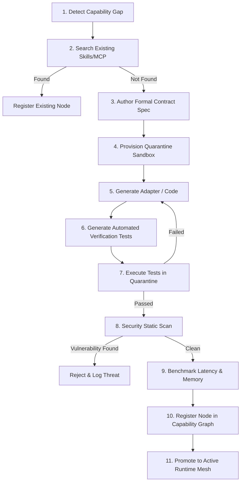

# MATRIX X1 — CAPABILITY FABRIC & ACQUISITION LAB
**System:** MATRIX X1 (`orchestration-agent-x1`)  
**Components:** `matrix/capabilities/capability-graph.js` & `matrix/capabilities/capability-acquisition.js`  
**Standard:** Sandboxed Quarantine Proving & Dynamic Capability Composition  

---

## 1. Capability Graph Topology

The Capability Fabric models all functional abilities of Matrix X1 as an explicit directed property graph:

```
[CAPABILITY GRAPH NODES & EDGES]
(Node: Capability)
  ├── id: Unique capability identifier (e.g. `csv_parser`, `browser_session`)
  ├── name: Human-readable title
  ├── type: `tool`, `skill`, `mcp`, `native`, or `compound`
  ├── status: `AVAILABLE`, `PARTIAL`, `MISSING`, or `UNKNOWN`
  ├── confidence: Empirical Bayesian score [0.0 - 1.0]
  └── edges:
        ├── depends_on -> [Dependency Capability IDs]
        ├── provides   -> [High-level Feature IDs]
        └── alternative_to -> [Fallback Capability IDs]
```

---

## 2. Dynamic Capability Gap Analysis

When a mission requires a capability, the Gap Detector evaluates whether the requirement can be satisfied:
- **`AVAILABLE`:** Direct, verified capability exists with confidence $\ge 0.70$.
- **`PARTIAL`:** Capability exists but confidence is low or required platform options are missing.
- **`MISSING`:** No direct node satisfies the requirement; triggers Compound Composer or Acquisition Lab.
- **`UNKNOWN`:** Frontier territory; capability must be researched before acquisition.

### Compound Capability Composition

If an atomic capability is missing, the Compound Composer traverses the graph to find functional compositions:
$$\text{Requirement}(\text{FetchAndConvert}) = \text{Node}(\text{curl\_fetch}) \circ \text{Node}(\text{json\_parser})$$

If a viable composition graph path exists, Matrix X1 executes the compound workflow without requiring external downloads or new code.

---

## 3. The 11-Step Quarantine Proving Ladder

When a true gap is detected that cannot be satisfied by existing nodes or compositions, the Capability Acquisition Engine initiates the 11-step proving ladder:



### Proving Steps in Detail:
1. **Detect Gap:** Objective analysis indicates missing capability ID.
2. **Search Ecosystem:** Check built-in skills, registered MCP servers, and npm/system packages.
3. **Formal Specification:** Define inputs, outputs, error conditions, and invariants.
4. **Quarantine Sandbox:** Create isolated directory at `.matrix_data/sandboxes/quarantine-{id}/`.
5. **Code Authoring:** Generate minimalist JS/Python adapter following the Ponytail Rule (shortest working code).
6. **Test Generation:** Author unit assertions covering normal cases, edge boundaries, and invalid input.
7. **Isolated Test Execution:** Run tests strictly inside the quarantine sandbox using child processes with timeouts.
8. **Security Scan:** Scan code for shell injection patterns, unauthorized network calls, and credential leakage.
9. **Profiling:** Measure execution latency (ms) and peak memory usage (MB).
10. **Graph Registration:** Insert new node into Capability Graph with verified confidence ($0.90$).
11. **Promotion:** Link module into active Tool Router mesh.

---

## 4. Disk Persistence & Audit Trail

All capability nodes and acquisition histories are preserved on disk:
- **Graph Storage:** `.matrix_data/matrix-capabilities.json`
- **Quarantine Sandboxes:** `.matrix_data/sandboxes/quarantine-*/`
- **Acquisition Log:** `.matrix_data/matrix-acquisitions-log.json`

---

## 5. Runtime Inspection & Diagnostics

Commander commands for inspecting capability fabric:
- `matrix x1 capabilities`: Lists all registered capabilities with confidence scores and statuses.
- `matrix x1 capability-gap`: Analyzes unmet mission requirements and identifies potential acquisition targets.
