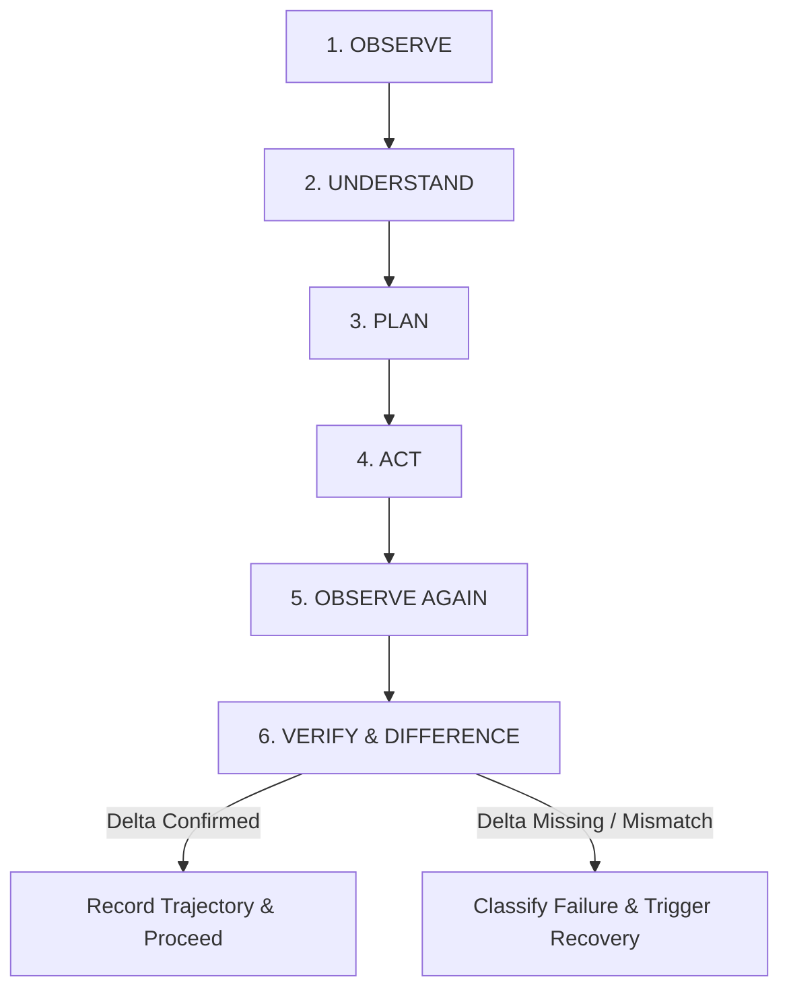

# MATRIX X1 — COMPUTER-USE AUTONOMY ENGINE
**System:** MATRIX X1 (`orchestration-agent-x1`)  
**Component:** `matrix/tools/computer-use.js`  
**Standard:** Closed-Loop Environmental Observation, Differencing & Safe Recovery  

---

## 1. Universal Environment Controller

Matrix X1 interacts with the host digital environment through the Computer Use Engine, an environment-aware controller designed to operate across multiple operating systems:

```
[HOST ENVIRONMENT PROFILER]
├── Operating System: Windows (Active: win32), Linux, or Container
├── Shell Architecture: PowerShell / Bash / Zsh
├── Window Manager: Desktop GUI / Headless Terminal / Virtual Framebuffer
├── Process Census: Live PIDs, Active Titles, Working Sets
└── Display Topology: Virtual Screen Coordinates, DPI Scale, Active Focus
```

---

## 2. The 6-Phase Closed-Loop Action Protocol

Matrix X1 strictly prohibits "blind action sequences" (planning 10 clicks and executing them without checking results). Every interaction follows the verified 6-phase loop:



### Action Loop Detail:
1. **OBSERVE:** Query active window titles, process list, focused window PID, terminal state, and capture screen/text state.
2. **UNDERSTAND:** Parse application state, identify interactive elements, verify application responsiveness.
3. **PLAN:** Select targeted interaction (keystroke sequence, process launch, CLI command, clipboard transfer).
4. **ACT:** Execute action with timeout and process guard.
5. **OBSERVE AGAIN:** Re-sample active window, process list, and visual/text output immediately after execution.
6. **VERIFY:** Compute mathematical difference between Pre-State and Post-State. Only declare success if the expected delta is confirmed.

---

## 3. Multi-Modal State Differencing

Differencing measures state changes across four orthogonal vectors:

| Differencing Dimension | Pre-State Probe | Post-State Probe | Verification Condition |
| :--- | :--- | :--- | :--- |
| **Window Focus & Title** | `preState.activeWindow` | `postState.activeWindow` | Window title or PID matches expected target application. |
| **Process Census** | `preState.processes` | `postState.processes` | New process launched or terminated as specified by goal. |
| **Filesystem Side Effect** | File existence / hash | File existence / hash | Target file created, updated, or removed with correct bytes. |
| **Output Buffer / Stream** | Terminal buffer offset | Terminal buffer offset | Expected output substring or exit code $0$ returned. |

If no difference is observed ($\Delta = \emptyset$) after an action that expected a side effect, the action is marked **UNCERTAIN** and does not proceed blindly.

---

## 4. Failure Recovery Classification

When an action fails or expected state delta is absent, the engine classifies the root cause:

```
[FAILURE TAXONOMY]
├── WRONG_TARGET         # Focus landed on unexpected background window or popup
├── STALE_STATE          # UI updated or re-rendered while action was executing
├── UNRESPONSIVE_APP     # Process hanging or waiting on blocked I/O
├── PERMISSION_DENIED    # Action requires elevated administrative privileges
└── ENVIRONMENT_MISMATCH # Shell or OS does not support the requested command syntax
```

### Automated Recovery Strategies:
- **WRONG_TARGET:** Re-focus target window by PID; re-validate focus before re-typing.
- **STALE_STATE:** Re-observe state; regenerate plan from new baseline.
- **UNRESPONSIVE_APP:** Emit `app.unresponsive` event; wait with exponential backoff (up to 3 attempts); terminate or restart process if authorized.
- **PERMISSION_DENIED:** Escalate to Commander for privilege grant; do not attempt forbidden workarounds.

---

## 5. Trajectory Logging & Replay

Every executed computer-use action writes an immutable record to disk in JSONL format:
- **Trajectory Path:** `.matrix_data/trajectories/computer-use-{session_id}.jsonl`
- **Captured Record Format:**
```json
{
  "timestamp": 1775691000000,
  "action_id": "act_882910",
  "goal": "Inspect background PowerShell processes",
  "pre_state": { "activeWindow": "Matrix X1 Terminal", "processCount": 182 },
  "action": { "type": "exec_command", "cmd": "Get-Process -Name node" },
  "post_state": { "activeWindow": "Matrix X1 Terminal", "processCount": 182, "exitCode": 0 },
  "delta_detected": true,
  "verification": "SUCCESS",
  "latency_ms": 14.5
}
```

---

## 6. Runtime Inspection & Diagnostics

Commander commands for inspecting computer-use state:
- `matrix x1 computer`: Shows active environment configuration, active window, and trajectory statistics.
- `matrix x1 benchmark-computer`: Runs live 10-task computer-use verification suite.
