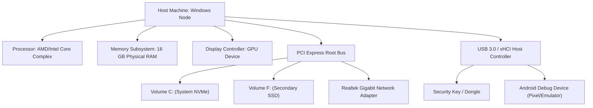

# MATRIX X1 — DEVICE INTEGRATION & MACHINE GRAPH FABRIC
**System:** MATRIX X1 (`orchestration-agent-x1`)  
**Component:** `matrix/devices/device-engine.js`  
**Standard:** Real PnP Hardware Census, Safe Probing & Topology Modeling  

---

## 1. Physical Environment Grounding

An autonomous agent operating strictly inside an abstract virtual environment is blind to its physical host constraints. Unexpected drive disconnections, thermal throttling, USB peripheral changes, or network adapter shifts can cause unhandled failures.

Matrix X1 grounds its awareness in the physical host via the Device Fabric:
- **Live Hardware Census:** Real queries to OS Plug-and-Play (PnP) controllers.
- **Dynamic Machine Graph:** Structural topology mapping CPU, GPU, storage volumes, USB hubs, and peripherals.
- **Device Event Bus:** Reactive event emission on hardware hot-plugs and unplugs.
- **Safe Probe Autonomy Loop:** Non-invasive inspection guaranteeing zero risk of hardware bricking.

---

## 2. Host Hardware Census

On Windows, the Device Engine executes live PowerShell queries against the Windows Management Instrumentation (WMI) and Common Information Model (CIM):

```powershell
Get-PnpDevice -PresentOnly | Select-Object InstanceId, Class, FriendlyName, Status
```

### Extracted Hardware Classes:
- `DiskDrive`: Active storage media, partitions, NVMe/SATA health.
- `Display`: GPU controllers and attached monitors.
- `Net`: Ethernet and Wi-Fi network interfaces.
- `USB`: External microcontrollers, cameras, security keys, serial adapters.
- `Processor`: Core count, architecture, clock capabilities.

---

## 3. The Machine Graph Topology

The Device Engine models the host as an explicit dependency graph:



Every hardware node records:
- `id`: Unique instance ID (e.g. `USB\VID_18D1&PID_4EE7...`)
- `friendly_name`: Human-readable device title.
- `class`: PnP classification category.
- `status`: `OK`, `DEGRADED`, `DISCONNECTED`, or `UNKNOWN`.
- `capabilities`: Inferred operational abilities (e.g. `adb_debugging`, `fast_storage`, `gpu_compute`).

---

## 4. Mobile & ADB Integration Bridge

For mobile automation, testing, and device research, the engine detects and integrates Android Debug Bridge (`adb`):
1. **Bridge Discovery:** Searches system `PATH` and Android SDK directories for `adb.exe`.
2. **Device Enumeration:** Queries `adb devices -l` to discover connected phones or emulators.
3. **State Inspection:** Inspects battery level, screen orientation, and installed package manifests via safe ADB shell commands.
4. **Sandboxed Automation:** Dispatches Android actions (touch, intent, UI dump) when requested by mission sub-plans.

---

## 5. Safe Probe Autonomy Loop

Hardware probing carries inherent physical risks. Matrix X1 implements strict safety boundaries for autonomous device probing:

```
[SAFE PROBE PROTOCOL]
├── READ-ONLY ACCESS: Only status, version, and sensor queries permitted.
├── FORBIDDEN ACTIONS: No firmware flashing, no EEPROM writes, no format commands.
├── VOLTAGE / CLOCK LOCK: Autonomous alteration of fan curves, voltages, or multipliers is strictly rejected.
└── TIMEOUT GUARD: All hardware queries enforce a 5-second hard timeout to prevent bus lockups.
```

If an unknown device is plugged in, Matrix X1:
1. Emits `device.connected` event.
2. Queries safe PnP metadata (Vendor ID, Product ID, Device Class).
3. Matches device against known Capability nodes.
4. Updates the Machine Graph without interrupting active missions.

---

## 6. Runtime Inspection & Diagnostics

Commander commands for inspecting physical devices:
- `matrix x1 devices`: Lists all currently detected hardware devices and statuses.
- `matrix x1 machine-graph`: Displays full hierarchical topology of host hardware nodes.
