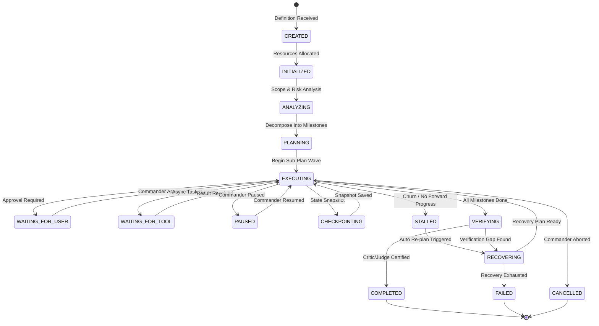

# MATRIX X1 — LONG-HORIZON AUTONOMY & DURABLE MISSIONS
**System:** MATRIX X1 (`orchestration-agent-x1`)  
**Component:** `matrix/missions/mission-engine.js`  
**Standard:** Durable State Continuity, Stall Detection & Heartbeat Verification  

---

## 1. Challenges of Long-Horizon Autonomous Execution

Long-horizon autonomous execution (tasks spanning hours or days, multiple tool calls, environment reboots, and interrupted processes) suffers from three classical failure modes:
1. **Context Drift:** Agent forgets high-level goals as context windows fill with transient tool traces.
2. **Pseudo-Progress Loops (Churn):** Agent repeatedly calls tools and generates output without actually advancing towards milestone completion.
3. **Volatile State Loss:** System crashes, power loss, or terminal restarts erase all in-memory progress, requiring cold restarts.

Matrix X1 resolves these problems with a durable **15-state mission lifecycle**, **periodic heartbeat telemetry**, **objective stall detection**, and **disk-persisted state continuity**.

---

## 2. The 15-State Mission Lifecycle



### Full 15 Lifecycle States:
1. `CREATED`: Mission registered in queue.
2. `INITIALIZED`: Memory scopes, workspaces, and token quotas allocated.
3. `ANALYZING`: Problem space parsed against Knowledge Fabric and Unknown Space.
4. `PLANNING`: Hierarchical milestone graph constructed.
5. `EXECUTING`: Active task execution by specialized agents and tools.
6. `WAITING_FOR_USER`: Suspended pending high-risk approval or clarification.
7. `WAITING_FOR_TOOL`: Suspended awaiting long-running background tasks.
8. `PAUSED`: Halted by human commander via `matrix x1 pause`.
9. `CHECKPOINTING`: State tree serialized to persistent disk storage.
10. `RECOVERING`: Rollback to previous clean checkpoint following an anomaly.
11. `STALLED`: Churn detected without milestone progress.
12. `VERIFYING`: Anti-fabrication Critic/Judge performing empirical verification.
13. `COMPLETED`: All success criteria certified with evidence.
14. `FAILED`: Terminal error after exhausting retry and recovery ladder.
15. `CANCELLED`: Explicitly aborted by commander.

---

## 3. Heartbeat Tracking & Stall Detection

To distinguish genuine progress from infinite looping:
- **Periodic Heartbeat:** Every mission emits a heartbeat timestamp every 30 seconds.
- **Progress Tracking:** Every task records `milestone_index`, `sub_task_index`, and `delta_hash`.
- **Stall Detector Rule:**
  $$\text{Stall Condition} \iff \Delta_{\text{time}} > T_{\text{threshold}} \quad \land \quad \Delta_{\text{milestones}} = 0 \quad \land \quad \text{ToolCalls} \ge 10$$

If an agent makes 10 consecutive tool calls without advancing the milestone state or producing a verified artifact, the Mission Engine immediately halts the execution loop, marks the mission `STALLED`, and triggers the Recovery / Re-planning engine.

---

## 4. Hierarchical Planning & Milestone Decomposition

Missions are never represented as flat task lists. The engine builds a 4-tier hierarchy:
```
MISSION (Top-level goal, success contract, budget cap)
  └── MILESTONES (Durable phases with concrete acceptance criteria)
        └── SUB-PLANS (Dependency waves executed sequentially or in parallel)
              └── ATOMIC TASKS (Single tool call or agent prompt with verification)
```

Each completed milestone writes an incremental checkpoint to disk, ensuring that even catastrophic failures never roll back work prior to the last verified milestone.

---

## 5. Cross-Restart State Continuity

State is persisted automatically:
- **Registry File:** `.matrix_data/matrix-missions.json`
- **Checkpoint Directory:** `.matrix_data/checkpoints/mission-{id}-chk-*.json`
- **Reboot Resilience:** On kernel startup, `missionEngine.init()` scans the registry for active missions in `EXECUTING` or `PAUSED` states and resumes them seamlessly from their last checkpoint.

---

## 6. Runtime Inspection & Diagnostics

Commander commands for inspecting long-horizon missions:
- `matrix x1 missions`: Displays active, completed, and stalled missions.
- `matrix x1 autonomy`: Shows overall autonomy metrics, heartbeat statuses, and stall counts.
- `matrix x1 benchmark-long`: Runs 10-task long-horizon mission validation suite.
