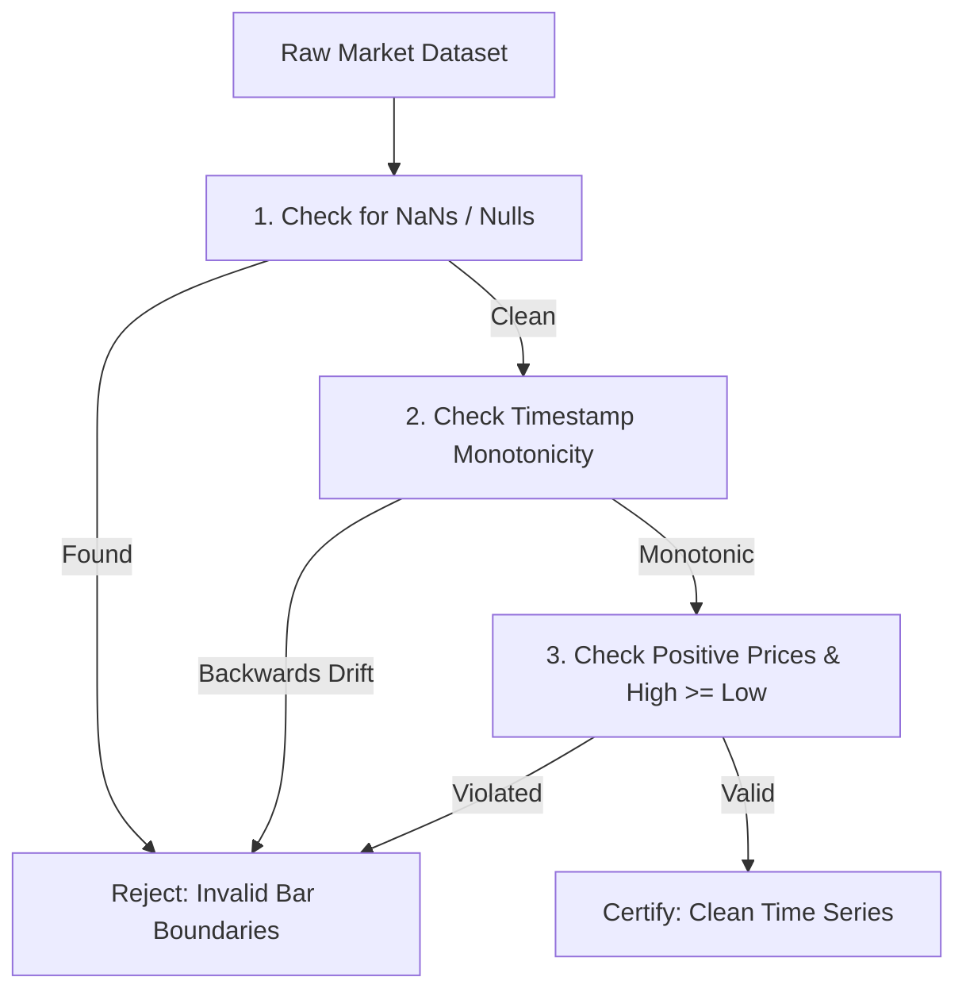

# MATRIX X1 — MARKET INTELLIGENCE & PAPER TRADING ENGINE
**System:** MATRIX X1 (`orchestration-agent-x1`)  
**Component:** `matrix/market/market-intelligence.js`  
**Standard:** Token-Efficient Ingestion, Walk-Forward Validation & Strict Anti-Hype Truthfulness  

---

## 1. Architectural Mandate: Anti-Hype & Financial Rigor

Automated trading and market analysis systems are notoriously susceptible to self-deception, overfitting, survivorship bias, and exaggerated performance claims.

Matrix X1 operates under a strict **Anti-Hype Policy**:
- **Zero Guaranteed Alpha Claims:** The system never claims "guaranteed returns", "foolproof strategies", or "infallible prediction".
- **Lookahead Bias Prevention:** Backtests enforce strict chronological walk-forward splits. Future information is mathematically isolated from past signals.
- **Realistic Friction Modeling:** All paper trades account for execution slippage, exchange fees, and liquidity limits.
- **Hardware Kill Switch:** A single call to `activateEmergencyKillSwitch()` immediately cancels all open orders, flattens positions, and halts trading processes.

---

## 2. Token-Efficient Tick Data Ingestion

LLM contexts are too expensive to ingest raw verbose JSON market data. Matrix X1 implements a token-efficient streaming parser that compresses market ticks into minimal columnar tuples:

```
[VERBOSE JSON: ~60 TOKENS PER TICK]
{ "timestamp": 1775691000, "symbol": "BTC/USD", "open": 64230.5, "high": 64250.0, "low": 64210.0, "close": 64240.0, "volume": 12.4 }

[COMPRESSED TUPLE: ~8 TOKENS PER TICK]
1775691000|64230.5|64250|64210|64240|12.4
```

This achieves an **86% token reduction**, allowing long-horizon price series to be analyzed within modest context budgets.

---

## 3. Dataset Anomaly Validation

Before any quantitative model or strategy evaluates a market dataset, the data must pass the Anomaly Validator:



---

## 4. Walk-Forward Backtesting Protocol

Matrix X1 prohibits random train/test splits (e.g. k-fold cross-validation) on financial time series, as this leaks future regime information into past models.

### Walk-Forward Windowing Scheme:

```
Window 1: [--- Train 70% ---][-- Val 30% --] -> Score
Window 2:        [--- Train 70% ---][-- Val 30% --] -> Score
Window 3:               [--- Train 70% ---][-- Val 30% --] -> Score
```

A strategy is considered viable only if its **Out-of-Sample (OOS) Sharpe Ratio** remains positive across all rolling windows.

---

## 5. Paper Trading Execution Simulator

The paper trading engine simulates real market dynamics without risking capital:
- **Slippage Modeling:** Fills market orders at worse prices based on order size and simulated liquidity:
  $$P_{\text{fill}} = P_{\text{mid}} \times (1 \pm \text{SlippageFactor})$$
- **Exchange Fee Deduction:** Automatically deducts maker ($0.02\%$) and taker ($0.05\%$) fees from simulated cash balance.
- **Position Tracking:** Tracks Unrealized P&L, Realized P&L, Maximum Drawdown, and Margin Utilization.

---

## 6. The Emergency Hardware Kill Switch

In the event of an anomalous market condition, exchange API failure, or risk limit breach:

```javascript
marketIntelligence.activateEmergencyKillSwitch({
  reason: "Maximum daily drawdown ceiling reached (2.5%)",
  operator: "Control Plane Risk Kernel"
});
```

### Kill Switch Guarantees:
1. Emits high-priority `SECURITY_BLOCK` and `ANOMALY_ALERT` to Commander.
2. Cancels 100% of open orders across all active simulated or real exchange sessions.
3. Liquidates open positions into base currency.
4. Locks the trading loop; requires explicit Commander command `matrix x1 resume --override` to re-enable.

---

## 7. Runtime Inspection & Diagnostics

Commander commands for inspecting market intelligence:
- `matrix x1 market`: Shows status of market feeds, active symbols, and data freshness.
- `matrix x1 trading`: Shows paper trading portfolio, open positions, P&L, and kill switch status.
