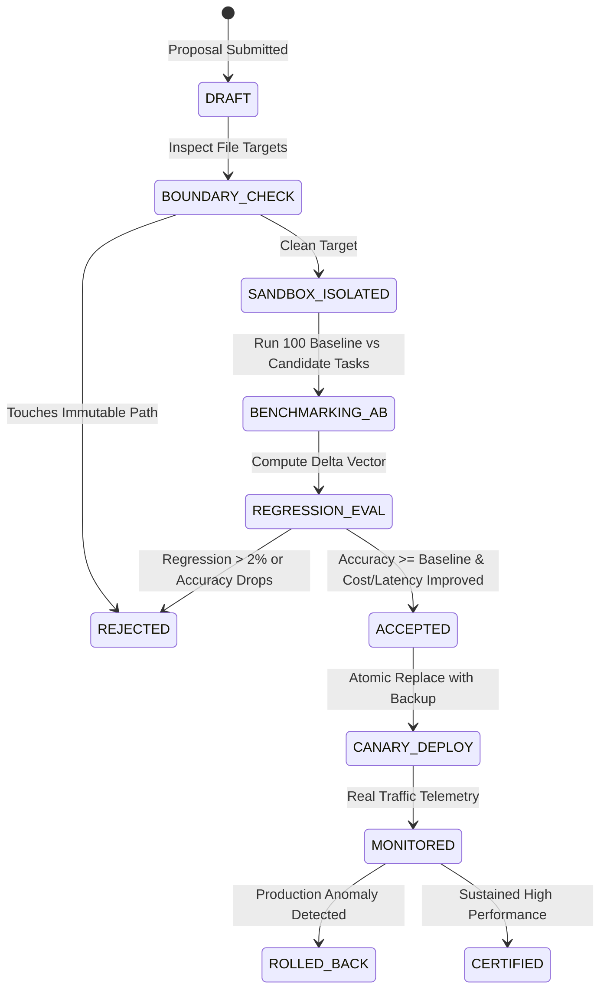

# MATRIX X1 — EMPIRICAL SELF-IMPROVEMENT LABORATORY
**System:** MATRIX X1 (`orchestration-agent-x1`)  
**Component:** `matrix/learning/self-improvement.js`  
**Standard:** Controlled Empirical Mutation with Immutable Safety Locks  

---

## 1. Architectural Philosophy

Autonomous self-improvement in Matrix X1 is strictly scientific and empirical. The system **never** modifies its own codebase based on unverified LLM proposals, speculative refactors, or unchecked self-edits.

Every proposed improvement must pass through an isolated proving pipeline:
1. **Hypothesis Formulation:** Explicit objective, expected delta, target subsystem.
2. **Boundary Validation:** Rejection if proposal touches immutable core files.
3. **Empirical A/B Benchmarking:** Identical benchmark suite run against baseline and candidate.
4. **Statistical Regression Gate:** Rejection if any regression exceeds $2\%$, or if safety drops.
5. **Atomic Commit & Rollback Guarantee:** Immediate reversal if post-deployment metrics degrade.

---

## 2. Immutable Boundary Locks

The Control Plane enforces strict immutable locks that autonomous self-improvement can **never** modify or propose changes to:

```
[IMMUTABLE BOUNDARIES — WRITE-PROTECTED]
├── .agents/v4/**                 # Orchestration Agent V4 Baseline (Rollback Anchor)
├── matrix/kernel/security-kernel.js # Security & Authorization Policies
├── matrix/commander/**           # Commander Authority & Communication Ladder
├── matrix/verification/critic-judge.js # Anti-Fabrication Engine & Proof Verifier
└── .planning/config/**           # System-Level Safety Configurations
```

Any proposal attempting to touch these paths is immediately marked `REJECTED_BOUNDARY_VIOLATION` with zero compute expended on testing.

---

## 3. Proposal Lifecycle State Machine



### Lifecycle States:
- `DRAFT`: Initial candidate proposal formulated with target file, rationale, and diff.
- `BOUNDARY_CHECK`: Control Plane static analysis verifying no protected paths are touched.
- `SANDBOX_ISOLATED`: Candidate code deployed in isolated quarantine directory (`.matrix_data/sandboxes/candidate-*`).
- `BENCHMARKING_AB`: Real execution of 100 test tasks measuring:
  - Task completion accuracy ($\%$)
  - Execution latency (ms)
  - Token consumption (budget units)
  - Error rate ($\%$)
- `REGRESSION_EVAL`: Strict statistical delta check:
  $$\Delta_{\text{accuracy}} \ge 0\% \quad \text{and} \quad \Delta_{\text{regressions}} \le 2\%$$
- `ACCEPTED` / `REJECTED`: Decision recorded with justification in Decision Journal.
- `CANARY_DEPLOY` / `ROLLED_BACK`: Atomic deployment with immediate rollback pointer.

---

## 4. Empirical A/B Testing Protocol

Self-improvement decisions are driven by the empirical benchmark suite in [matrix/tests/benchmarking.js](file:///c:/Users/abhis/Downloads/pt/matrix/tests/benchmarking.js).

### Evaluation Metrics Formula

For any candidate $C$ evaluated against baseline $B$ across $N$ tasks:

$$\text{Improvement Score} = 0.50 \cdot (\text{Acc}_C - \text{Acc}_B) + 0.30 \cdot \left(\frac{\text{Lat}_B - \text{Lat}_C}{\text{Lat}_B}\right) + 0.20 \cdot \left(\frac{\text{Tokens}_B - \text{Tokens}_C}{\text{Tokens}_B}\right)$$

A candidate is **only** accepted if:
1. $\text{Acc}_C \ge \text{Acc}_B$ (Zero tolerance for accuracy regression).
2. $\text{Regressions} \le 0$ on all core functional invariants.
3. Improvement Score $> +0.05$ (meaningful positive impact).

---

## 5. Rate Limits & Cooldowns

To prevent runaway mutation loops and thrashing:
- **Maximum Proposals per Hour:** 5 proposals.
- **Cooldown Period:** 15 minutes between consecutive candidate evaluations.
- **Daily Budget Cap:** 10,000 compute units allocated to self-improvement sandboxes.
- **Rollback Quarantine:** Any module whose candidate triggers a rollback is locked from further mutations for 24 hours.

---

## 6. Disk Persistence & Audit Trail

All self-improvement activity is permanently recorded to disk:
- **Ledger Path:** `.matrix_data/matrix-self-improvement-ledger.json`
- **Fields Captured:** `proposal_id`, `timestamp`, `author_agent`, `target_subsystem`, `baseline_metrics`, `candidate_metrics`, `delta`, `verdict`, `rejection_reason`, `backup_path`.
- **Inspection Command:** `matrix x1 improvements`
