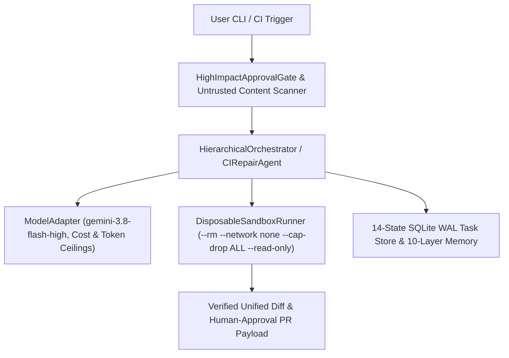

# AGI 1.7 — OMEGA COMMAND
## Resource-Aware, Sandboxed Multi-Agent Coding & Python CI-Repair Runtime (`gemini-3.8-flash-high`)

[](agents/AGI_1_7/run_agi_17.py)
[](agents/AGI_1_7/engine/agi17/adapters/model_adapter.py)
[-0284C7.svg)](agents/AGI_1_7/engine/agi17/process_supervision/sandbox_runner.py)
[](agents/AGI_1_7/ecosystem/agent_registry/registry.json)
[](.github/workflows/agi17-ci.yml)

**AGI 1.7 — OMEGA COMMAND** is a self-contained, resource-aware, persistent multi-agent engineering and automated **Python CI-Repair** runtime built around **Google's Gemini 3.8 Flash High (`gemini-3.8-flash-high`)** using the **Python 3.10+ Standard Library** (`0` third-party PyPI runtime dependencies required).

> [!IMPORTANT]
> **What This Repository Is (And What It Is Not)**
> - **Orchestration & Sandboxed Verification Runtime:** AGI 1.7 is a multi-agent orchestration, transactional SQLite WAL task-control, disposable Docker sandbox, and persistent-memory system wrapping `gemini-3.8-flash-high` via [`ModelAdapter`](agents/AGI_1_7/engine/agi17/adapters/model_adapter.py). It is **not** a custom pre-trained or fine-tuned base LLM.
> - **1 Unified Entrypoint (`AGI 1.7`) with 100 Embedded Specialist Contracts:** All 100 schema-validated specialist contracts across 16 functional families ([`registry.json`](agents/AGI_1_7/ecosystem/agent_registry/registry.json)) are embedded inside [`agents/AGI_1_7/`](agents/AGI_1_7/) and coordinated dynamically with Ponytail minimal-diff railings via [`EcosystemCoordinator`](agents/AGI_1_7/ecosystem/agent_registry/ecosystem_coordinator.py).
> - **Focused Commercial Product Workflow (`CIRepairAgent`):** Includes a dedicated **Automated Python CI-Repair & Test-Healing Agent** ([`ci_repair_agent.py`](agents/AGI_1_7/engine/agi17/orchestration/ci_repair_agent.py), [`PRODUCT_SPEC_PYTHON_CI_REPAIR.md`](agents/AGI_1_7/docs/PRODUCT_SPEC_PYTHON_CI_REPAIR.md), [`PRODUCTION_READINESS_AND_COMMERCIAL_DOSSIER.md`](agents/AGI_1_7/docs/PRODUCTION_READINESS_AND_COMMERCIAL_DOSSIER.md)) that reproduces failing `unittest` suites inside a network-disabled disposable container, synthesizes a minimal root-cause patch under strict USD/token ceilings, verifies zero test regressions inside the sandbox, and stages a unified diff and reviewable PR payload (`requires_human_approval=True`).

---

## 📊 1. Transparent Evaluation & Verification Summary (5 Distinct Categories)

To prevent conflating deterministic unit tests with live LLM benchmark runs, all results in this repository are strictly separated into five verifiable categories:

### Category 1: Deterministic Runtime, Sandbox & Security Verification (`69 / 69` Offline Tests)
Executed automatically on every push and Pull Request across `ubuntu-latest` and `windows-latest` ([`.github/workflows/agi17-ci.yml`](.github/workflows/agi17-ci.yml)):
- **[`test_production_hardening_sprint.py`](agents/AGI_1_7/tests/test_production_hardening_sprint.py) (`20 / 20` passing):** Repository secret/path leak scan (`0` leaks), typed `ModelRequest`/`ModelResponse`/`ModelProviderConfig`, `DeterministicMockProvider`, USD cost budget ceiling enforcement (`ModelCostBudgetExceededError`), `DisposableSandboxRunner` execution & `finally:` cleanup, `PathTraversalViolationError` & symlink/device-file rejection, prompt-injection/malicious-code blocking (`UntrustedContentSecurityError`), fail-closed `SandboxPolicy.production()` (`SandboxIsolationUnavailableError`, immutable SHA-256 digest `python:3.12-slim@sha256:a6e34c598f2467ed0e9a8d349809fcd8b5c603269512df273a0bb1784edc11b1`, `verified_network_isolated`), `HighImpactApprovalGate.check_structured_action()`, Layer 7 self-learning failure memory (`record_failure_lesson` + `build_compact_memory_prompt_block`), SQLite task `idempotency_key` deduplication, corrupted checkpoint crash recovery (`reconcile_after_restart`), distinct CLI exit codes (`0..6`), nested package full-suite regression verification, 5-tier capability maturity breakdown, 50-task held-out suite integrity, and end-to-end `CIRepairAgent` staged-patch verification.
- **[`test_agi17_unit_suite.py`](agents/AGI_1_7/tests/unit/test_agi17_unit_suite.py) (`26 / 26` passing):** 100-contract JSON schema validation, 14-state SQLite WAL transitions, DFS dependency cycle detection, SHA-256 checkpoint verification, and SSRF firewall rules.
- **[`test_agi17_integration_suite.py`](agents/AGI_1_7/tests/integration/test_agi17_integration_suite.py) (`16 / 16` passing):** Crash recovery (`reconcile_after_restart()`), live `CommandInbox` mid-run overrides (`ADD_CHILD_TASK`, `PAUSE_CURRENT_AND_SWITCH`, `CANCEL_AND_REPLACE`, `REPRIORITIZE`), and 10-layer SQLite memory fact supersession.
- **[`test_agi17_e2e_demos.py`](agents/AGI_1_7/tests/end_to_end/test_agi17_e2e_demos.py) (`7 / 7` passing):** End-to-end DAG orchestration, disagreement self-healing, and detached background execution (`--detach`).

### Category 2: Live Multi-Agent Code $\rightarrow$ Test $\rightarrow$ Fail $\rightarrow$ Repair Trace
- **Artifact:** [`agents/AGI_1_7/reports/LIVE_MULTI_AGENT_EXECUTION_LOG.json`](agents/AGI_1_7/reports/LIVE_MULTI_AGENT_EXECUTION_LOG.json) (reproducible via [`demo_real_multi_agent_code_fix.py`](agents/AGI_1_7/scripts/demo_real_multi_agent_code_fix.py)).
- **Result:** `4` live `gemini-3.8-flash-high` calls (`70,708` provider-reported tokens, `\$0.015855` USD, `0` fallbacks): `plan_systems_architect` specifies contract $\rightarrow$ `swe_python_runtime_engineer` writes `interval_merger.py` $\rightarrow$ `qa_unit_suite_runner` writes 13 unit tests and detects 3 boundary failures (`exit_code=1`) $\rightarrow$ `swe_patch_minimizer` patches `interval_merger.py` from the `stderr` traceback $\rightarrow$ re-test passes `13 / 13` (`exit_code=0`).

### Category 3: 50-Task Held-Out Suite & Live 3-Way Coding Benchmark (`Config A` vs. `Config B` vs. `Config C`)
- **Report, 50-Task Suite & Raw Ledger:** [`HELDOUT_CODING_BENCHMARK_REPORT.md`](agents/AGI_1_7/reports/HELDOUT_CODING_BENCHMARK_REPORT.md) | [`heldout_coding_suite.py`](agents/AGI_1_7/benchmarks/heldout_coding_suite.py) (`50` tasks across `10` categories) | [`HELDOUT_CODING_BENCHMARK_RAW_RESULTS.json`](agents/AGI_1_7/reports/HELDOUT_CODING_BENCHMARK_RAW_RESULTS.json)
- **Scope Note:** `HELDOUT_CODING_50_SUITE` defines `50` tasks with SHA-256-locked graders; live 3-way model execution was performed on the `3` primary repository tasks (`9` unseen held-out `unittest` methods graded inside `DisposableSandboxRunner` with `--network none`).

| Metric | **Config A: `RAW_BASE_MODEL_SINGLE_SHOT`** | **Config B: `SINGLE_AGENT_REPAIR_LOOP`** | **Config C (Baseline Run 1)** | **Config C (Self-Improved Run 2)** |
| :--- | :---: | :---: | :---: | :---: |
| **Verified Tasks Completed (`100%` Unseen Tests Pass)** | `0 / 3` (`0.00%`) | `0 / 3` (`0.00%`) | `2 / 3` (`66.67%`) | **`3 / 3` (`100.00%`)** |
| **Unseen Held-Out Unit Tests Passed** | `4 / 7` (`57.14%`) | `4 / 9` (`44.44%`) | `8 / 9` (`88.89%`) | **`9 / 9` (`100.00%`)** |
| **Regression Rate (Broke Starter Module)** | `33.33%` | `33.33%` | `0.00%` | **`0.00%`** |
| **Failure / Timeout Rate** | `0.00%` | `33.33%` | `33.33%` | **`0.00%`** |
| **Average Latency per Task** | **`66.89s`** | `271.07s` | `221.14s` | **`168.63s`** (`-23.7%` vs Run 1) |
| **Total Tokens / Total Cost (USD)** | **`38,365` (`\$0.011823`)** | `95,820` (`\$0.029215`) | `218,552` (`\$0.060927`) | **`185,788` (`\$0.050967`)** |
| **Cost per Verified Completed Task (USD)** | `N/A` (`0` verified) | `N/A` (`0` verified) | `\$0.030464` | **`\$0.016989`** (`-44.2%` vs Run 1) |
| **Deterministic Fallbacks Used** | `False` (`0`) | `False` (`0`) | `False` (`0`) | **`False` (`0`)** |

*Engineering Trade-Off & Self-Learning Analysis:* By recording structured failure lessons in Layer 7 (`OmegaCommandMemory.record_failure_lesson()`), injecting a `<=120`-token guardrail (`build_compact_memory_prompt_block()`), and inspecting existing workspace `test_*.py` contracts before Stage 1/2 (skipping redundant LLM test generation in Stage 3 when starter tests already exist), `TASK-01-TOKEN-BUCKET` dropped from `4` model calls (`67,069` tokens, `224.08s`) to **`2` model calls (`34,305` tokens, `66.54s`, `-48.9%` tokens, `-70.3%` latency)** and achieved **`3 / 3` (`100.0%`)** verified task completion across the suite. When a repository **already** contains failing unit tests, use [`CIRepairAgent`](agents/AGI_1_7/engine/agi17/orchestration/ci_repair_agent.py) (`--ci-repair-dir`) to repair directly in `1` model call without multi-agent decomposition overhead.

### Category 4: External Academic Benchmark (`GPQA Diamond Clean 1.2.2`)
- **Cold-Start Strict Surface-Only Live Sample (`10` questions from scratch, zero checkpoint reuse):** **`9 / 10` (`90.00%` overall; `9 / 9 = 100.00%` on surfaced responses, `1` unanswered due to print timeout)** across Biology (`3/3`), Chemistry (`3/3`), and Physics (`3/4`), consuming `163,054` provider-reported tokens (`\$0.042618` USD). Raw transcript: [`GPQA_COLD_START_STRICT_SURFACE_RESULTS.json`](agents/AGI_1_7/reports/GPQA_COLD_START_STRICT_SURFACE_RESULTS.json).
- **Full 189-Item Clean Manifest Audit (`gpqa-diamond-clean v1.2.2`, `198 - 9 = 189` items):** Detailed in [`AGI_1_7_GPQA_CLEAN_189_REPORT.md`](agents/AGI_1_7/reports/AGI_1_7_GPQA_CLEAN_189_REPORT.md), separating strict surface-only grading (`allow_transcript_recovery = False` by default) from historical cached/checkpointed evaluation artifacts.

### Category 5: Token & Cost Accounting (`PROVIDER_REPORTED` vs. `LOCAL_ESTIMATE`)
- [`AdaptiveTokenController`](agents/AGI_1_7/engine/agi17/telemetry/token_economy.py) and [`ModelAdapter`](agents/AGI_1_7/engine/agi17/adapters/model_adapter.py) explicitly tag every ledger entry as `PROVIDER_REPORTED` (exact token counts returned by `agy.exe --output-format json`), `LOCAL_ESTIMATE` (heuristic fallback when CLI output omits usage metadata), or `MOCK_OFFLINE_TEST` (offline unit tests).
- **Qualification of `-88.2%` Isolated-CWD Input Token Savings:** Executing single-shot model calls inside `isolated_cwd` (`minimal_cli_home`) reduces **per-call input prompt overhead by `-88.2%`** (`2,683` vs `22,728` input tokens on identical prompts) by avoiding workspace directory context injection. Multi-turn coding and repair missions still consume proportional output and thinking tokens across specialist calls.

---

## 🛡️ 2. Production Security, Sandboxing & Governance Architecture



1. **Disposable Container Sandbox ([`sandbox_runner.py`](agents/AGI_1_7/engine/agi17/process_supervision/sandbox_runner.py)):**
   - Executes untrusted generated Python code and `unittest` suites inside a disposable Docker container (`--rm --network none --cap-drop ALL --security-opt no-new-privileges --read-only --tmpfs /tmp:rw,exec,nosuid,size=64m --cpus 1.0 --memory 256m --pids-limit 64`).
   - Supports strict fail-closed enforcement (`require_container_isolation=True` $\rightarrow$ raises `SandboxIsolationUnavailableError` if Docker is unavailable) and guaranteed `finally:` workspace destruction.
2. **Path Traversal, Prompt-Injection & High-Impact Action Guards:**
   - `validate_relative_sandbox_path()` blocks `..`, absolute paths, and symlink escapes (`PathTraversalViolationError`).
   - `scan_untrusted_content()` scans repository files for prompt injection (`IGNORE PREVIOUS INSTRUCTIONS`) and blocks credential access (`.gemini/config`, `.ssh/id_rsa`) or unauthorized network calls (`UntrustedContentSecurityError`).
   - `HighImpactApprovalGate` blocks `git push`, `pip install`, destructive deletes, and external network fetches without explicit human approval (`HighImpactActionBlockedError`).
3. **Hardened Model Integration ([`model_adapter.py`](agents/AGI_1_7/engine/agi17/adapters/model_adapter.py)):**
   - Typed `ModelRequest`, `ModelResponse`, and `ModelProviderConfig` contracts with `BaseModelProvider` and `DeterministicMockProvider`.
   - Enforces per-request (`max_request_cost_usd`) and per-mission (`max_mission_cost_usd`) USD cost ceilings, exponential backoff retries, rate limiting, and automatic credential/path redaction (`redact_sensitive_text()`).

---

## 🧠 3. Embedded 100-Specialist Registry & Ecosystem Coordination

[`CapabilityRouter`](agents/AGI_1_7/ecosystem/agent_registry/capability_router.py) and [`SpecialistFactory`](agents/AGI_1_7/ecosystem/agent_registry/specialist_factory.py) route tasks across **100 schema-validated specialist contracts** across 16 functional families in [`registry.json`](agents/AGI_1_7/ecosystem/agent_registry/registry.json):

| # | Specialist Family | Count | Representative Specialist IDs (`agents/AGI_1_7/ecosystem/agent_registry/contracts/`) |
| :-: | :--- | :-: | :--- |
| **1** | **Planning & Architecture** | **6** | `plan_mission_decomposer`, `plan_systems_architect`, `plan_dependency_analyzer`, `plan_risk_estimator` |
| **2** | **Research & Evidence Synthesis** | **8** | `res_primary_source_hunter`, `res_citation_auditor`, `res_contradiction_detector`, `res_sdk_doc_navigator` |
| **3** | **Mathematics & Symbolic Reasoning** | **6** | `math_algebraic_solver`, `math_combinatorics_analyst`, `math_probability_statistician`, `math_linear_algebra_verifier` |
| **4** | **Physics & Physical Sciences** | **6** | `phys_quantum_mechanics_reasoner`, `phys_relativistic_electrodynamics`, `phys_statistical_thermodynamics` |
| **5** | **Chemistry & Molecular Sciences** | **5** | `chem_organic_synthesis_planner`, `chem_spectroscopy_elucidator`, `chem_kinetics_thermochemistry` |
| **6** | **Biology & Biomedical Sciences** | **5** | `bio_molecular_genetics_reasoner`, `bio_cell_signaling_oncology`, `bio_biochemistry_enzymology` |
| **7** | **Software Engineering** | **10** | `swe_python_runtime_engineer`, `swe_ast_refactoring_specialist`, `swe_api_contract_designer`, `swe_patch_minimizer` |
| **8** | **Terminal, Shell & OS Operations** | **8** | `ops_powershell_automation_specialist`, `ops_posix_shell_specialist`, `ops_process_tree_warden` |
| **9** | **Containers, Virtualization & Cloud** | **6** | `virt_docker_engine_inspector`, `virt_wsl2_memory_governor`, `virt_harbor_sandbox_coordinator` |
| **10** | **Browser & Web Automation** | **6** | `web_playwright_session_controller`, `web_dom_accessibility_inspector`, `web_ssrf_robots_compliance_guard` |
| **11** | **Desktop & Computer Use** | **6** | `desk_sandbox_isolation_enforcer`, `desk_osworld_task_inspector`, `desk_gui_action_schema_validator` |
| **12** | **Data, Storage & Databases** | **6** | `data_sqlite_wal_architect`, `data_jsonl_ledger_reconciler`, `data_memory_supersession_curator` |
| **13** | **Testing, QA & Verification** | **8** | `qa_unit_suite_runner`, `qa_integration_scenario_verifier`, `qa_claim_to_evidence_verifier` |
| **14** | **Security, Permissions & Safety** | **6** | `sec_permission_gate_enforcer`, `sec_prompt_injection_shield`, `sec_secret_credential_scanner`, `sec_ssrf_network_firewall` |
| **15** | **Performance & Token Optimization** | **4** | `perf_adaptive_concurrency_governor`, `perf_token_budget_controller`, `perf_tail_latency_mitigator` |
| **16** | **Release, Governance & Reporting** | **4** | `gov_manifest_hash_sealer`, `gov_telemetry_dashboard_publisher`, `gov_release_dossier_compiler` |

---

## ⚡ 4. Quickstart & Reproducible Commands

### 1. Clone & Install (`pyproject.toml`)
```bash
git clone https://github.com/Abhishek200416/AGI-1.7V.git
cd AGI-1.7V
python -m pip install -e .
```

### 2. Run the Complete Offline Verification Suite (`69` Tests, `0` Live Tokens Spent)
```bash
python -m unittest \
  agents/AGI_1_7/tests/test_production_hardening_sprint.py \
  agents/AGI_1_7/tests/unit/test_agi17_unit_suite.py \
  agents/AGI_1_7/tests/integration/test_agi17_integration_suite.py \
  agents/AGI_1_7/tests/end_to_end/test_agi17_e2e_demos.py -v
```

### 3. Run the Focused Python CI-Repair Product Workflow (`--ci-repair-dir`)
```bash
python agents/AGI_1_7/run_agi_17.py \
  --ci-repair-dir agents/AGI_1_7/live_code_mission_workspace \
  --module-filename token_bucket.py \
  --prompt "Fix failing unit tests with minimal diff"
```

### 4. Run Multi-Specialist Coding, Sandboxed Testing & Self-Healing via Standard CLI
```bash
# Hardware capability profile & SQLite WAL crash reconciliation only:
python agents/AGI_1_7/run_agi_17.py --profile-only

# Full 3-specialist coding + sandboxed unittest + self-healing repair workflow:
python agents/AGI_1_7/run_agi_17.py \
  --title "Token Bucket Limiter" \
  --prompt "Implement TokenBucketRateLimiter in token_bucket.py" \
  --code-task-dir agents/AGI_1_7/live_code_mission_workspace \
  --module-filename token_bucket.py \
  --test-filename test_token_bucket.py \
  --inject-deliberate-test-failure

# Detached background daemon (survives closing Antigravity IDE):
python agents/AGI_1_7/run_agi_17.py --detach --task-id MISSION-BG-001 --prompt "Implement and verify module"
```

### 5. Run Live Benchmarks (With Pre-Flight Cost & Token Budget Enforcement)
```bash
# 3-Way Held-Out Coding Benchmark (Config A vs Config B vs Config C, enforces --max-budget-usd):
python agents/AGI_1_7/scripts/run_heldout_coding_benchmark.py --max-tasks 3 --max-budget-usd 0.25

# Cold-Start GPQA Diamond Clean 1.2.2 Strict Surface-Only Sample:
python agents/AGI_1_7/scripts/run_gpqa_clean_189_agi17.py --cold-start-sample-n 10
```

---

## 📚 5. Documentation, Security Audits & Provenance

- **Phase 0 Baseline & Security Audit:** [`agents/AGI_1_7/docs/PHASE_0_BASELINE_AND_SECURITY_AUDIT.md`](agents/AGI_1_7/docs/PHASE_0_BASELINE_AND_SECURITY_AUDIT.md)
- **Production Readiness, Strict Rubric Scorecard & Commercial Dossier:** [`agents/AGI_1_7/docs/PRODUCTION_READINESS_AND_COMMERCIAL_DOSSIER.md`](agents/AGI_1_7/docs/PRODUCTION_READINESS_AND_COMMERCIAL_DOSSIER.md)
- **Operations, Deployment & Troubleshooting Runbook:** [`agents/AGI_1_7/docs/OPERATIONS_AND_DEPLOYMENT_GUIDE.md`](agents/AGI_1_7/docs/OPERATIONS_AND_DEPLOYMENT_GUIDE.md)
- **Licensing, Provenance & Supply-Chain Report:** [`agents/AGI_1_7/docs/LICENSING_AND_PROVENANCE_REPORT.md`](agents/AGI_1_7/docs/LICENSING_AND_PROVENANCE_REPORT.md)
- **Third-Party Licenses & Provenance Inventory:** [`agents/AGI_1_7/docs/THIRD_PARTY_LICENSES_AND_PROVENANCE.md`](agents/AGI_1_7/docs/THIRD_PARTY_LICENSES_AND_PROVENANCE.md)
- **Product Spec — Automated Python CI-Repair Agent:** [`agents/AGI_1_7/docs/PRODUCT_SPEC_PYTHON_CI_REPAIR.md`](agents/AGI_1_7/docs/PRODUCT_SPEC_PYTHON_CI_REPAIR.md)
- **Technical Architecture & Engineering FAQ:** [`agents/AGI_1_7/docs/TECHNICAL_ARCHITECTURE_AND_FAQ.md`](agents/AGI_1_7/docs/TECHNICAL_ARCHITECTURE_AND_FAQ.md)
- **3-Way Held-Out Coding Benchmark Report:** [`agents/AGI_1_7/reports/HELDOUT_CODING_BENCHMARK_REPORT.md`](agents/AGI_1_7/reports/HELDOUT_CODING_BENCHMARK_REPORT.md)

