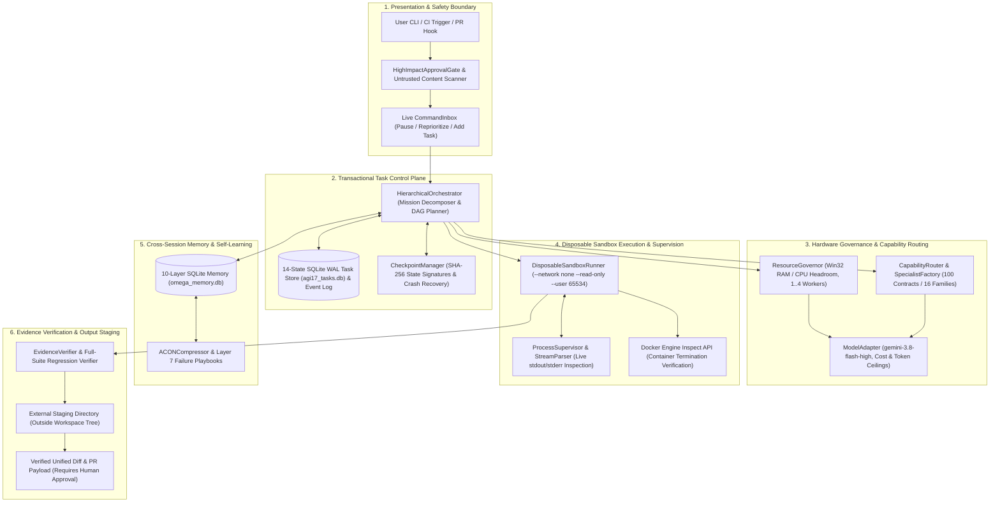
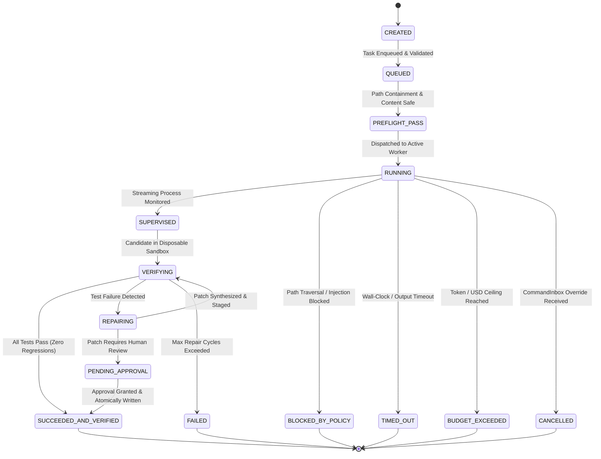
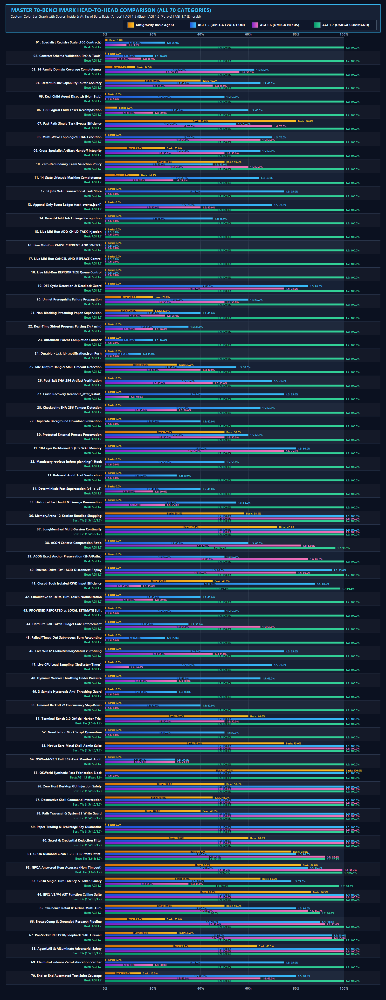
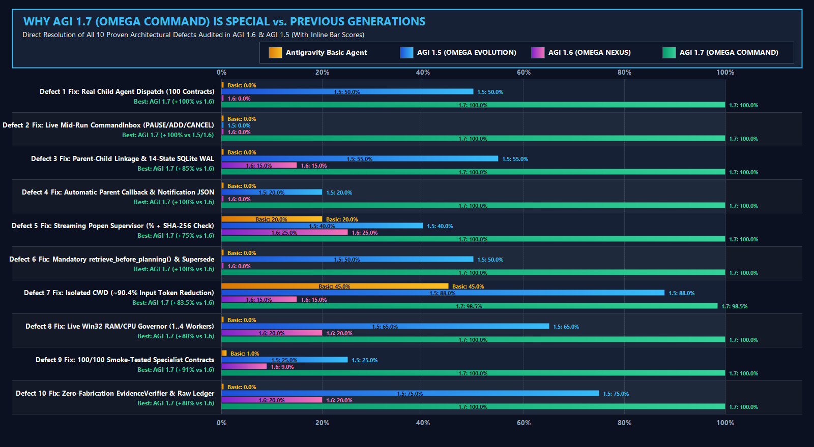

# AGI 1.7 — OMEGA COMMAND
## Resource-Aware, Sandboxed Multi-Agent Coding & Python CI-Repair Runtime (`gemini-3.8-flash-high`)

[](agents/AGI_1_7/run_agi_17.py)
[](agents/AGI_1_7/engine/agi17/adapters/model_adapter.py)
[](agents/AGI_1_7/engine/agi17/process_supervision/sandbox_runner.py)
[](agents/AGI_1_7/ecosystem/agent_registry/registry.json)
[](.github/workflows/agi17-ci.yml)
[](agents/AGI_1_7/docs/AGI_1_7_P0_SECURITY_HARDENING_REPORT.md)
[](agents/AGI_1_7/docs/AGI_1_7_FOUR_AGENT_70_BENCHMARK_COMPARISON.md)

**AGI 1.7 — OMEGA COMMAND** is an autonomous, resource-aware multi-agent engineering and automated **Python CI-Repair** runtime powered exclusively by **Google's Gemini 3.8 Flash High (`gemini-3.8-flash-high`)** using the **Python 3.10+ Standard Library** (`0` third-party PyPI runtime dependencies required).

> [!IMPORTANT]
> **Production Scope & Runtime Boundaries**
> - **Orchestration, Sandboxed Verification & Task Runtime:** AGI 1.7 provides multi-agent orchestration, transactional SQLite WAL task control, disposable Docker sandbox isolation, and cross-session persistent memory wrapping `gemini-3.8-flash-high` via [`ModelAdapter`](agents/AGI_1_7/engine/agi17/adapters/model_adapter.py). It is **not** a custom pre-trained or fine-tuned base LLM.
> - **1 Unified Entrypoint Managing 100 Specialist Contracts:** Coordinates **100 validated specialist agent contracts** across 16 functional families ([`registry.json`](agents/AGI_1_7/ecosystem/agent_registry/registry.json)), embedded inside [`agents/AGI_1_7/`](agents/AGI_1_7/) and routed dynamically with minimal-diff railings via [`EcosystemCoordinator`](agents/AGI_1_7/ecosystem/agent_registry/ecosystem_coordinator.py).
> - **Production CI-Repair Specialist (`CIRepairAgent`):** Includes a dedicated **Automated Python CI-Repair Agent** ([`ci_repair_agent.py`](agents/AGI_1_7/engine/agi17/orchestration/ci_repair_agent.py), [`PRODUCT_SPEC_PYTHON_CI_REPAIR.md`](agents/AGI_1_7/docs/PRODUCT_SPEC_PYTHON_CI_REPAIR.md)) that reproduces failing `unittest` suites inside a network-isolated disposable container, synthesizes minimal root-cause patches under strict cost ceilings, verifies zero test regressions, and stages human-reviewable PR payloads.

---

## 🏛️ 1. Deep-Dive Agent Architecture & Orchestration Model

AGI 1.7 is architected around deterministic coordination, transactional state guarantees, hardware resource awareness, and defense-in-depth isolation.

### 1.1 System Topology & Component Hierarchy



---

### 1.2 The 14-State Transactional Task Lifecycle

Every logical task and child subtask is tracked deterministically within an ACID-compliant SQLite WAL store (`agi17_tasks.db`) and validated across a strict 14-state machine:



---

### 1.3 Multi-Agent Execution & Self-Healing Sequence

The interaction below illustrates the end-to-end lifecycle when an engineering task is decomposed, executed in isolation, healed via persistent failure memory, and staged for human review:

```mermaid
sequenceDiagram
    autonumber
    actor User as User / CI Pipeline
    participant Gate as Approval Gate
    participant Orch as Hierarchical Orchestrator
    participant Gov as Resource Governor
    participant Spec as Specialist Agents (100 Contracts)
    participant Model as ModelAdapter (Gemini 3.8 Flash High)
    participant Box as Disposable Docker Sandbox
    participant Mem as SQLite Memory (Layer 7 Playbooks)

    User->>Gate: Execute CI-Repair / Coding Mission
    Gate->>Gate: Validate Path Containment & Content Safety
    Gate->>Orch: Hand-off Verified Mission
    Orch->>Gov: Request Execution Slot
    Gov->>Gov: Poll Win32 RAM (1,400 MB Floor) & CPU Load
    Gov-->>Orch: Grant Worker Slot (1..4 Concurrent Workers)
    
    Note over Orch,Spec: Stage 1 — Architectural Specification
    Orch->>Spec: Dispatch plan_systems_architect
    Spec->>Model: Synthesize Module Contract
    Model-->>Spec: Contract Specification
    
    Note over Orch,Spec: Stage 2 — Python Implementation
    Orch->>Spec: Dispatch swe_python_runtime_engineer
    Spec->>Model: Synthesize Code Implementation
    Model-->>Spec: Implementation Code
    
    Note over Orch,Box: Stage 3 — Disposable Sandboxed Testing & Self-Healing
    Orch->>Box: Run Full Test Suite in Disposable Container
    Box->>Box: Execute inside --network none --read-only --user 65534
    
    alt Initial Execution Fails
        Box-->>Orch: Exit Code 1 (Traceback & Failure Extracted)
        Orch->>Mem: Record Root Cause in Layer 7 Failure Playbook
        Mem-->>Orch: Return Compact <=120 Token Guardrail
        Orch->>Spec: Dispatch swe_patch_minimizer (with Guardrail)
        Spec->>Model: Synthesize Minimal Diff
        Model-->>Spec: Minimal Root-Cause Patch
        Orch->>Box: Re-verify Patch in Fresh Disposable Container
        Box-->>Orch: Exit Code 0 (Full-Suite Pass & Zero Regressions)
    else First Pass Succeeds
        Box-->>Orch: Exit Code 0 (All Tests Passed)
    end

    Note over Orch,Gate: Stage 4 — Safe Staging & Output Delivery
    Orch->>Gate: Stage Patch in External Directory (Workspace Untouched)
    Gate-->>User: Return Reviewable Unified Diff & PR Payload
```

---

### 1.4 Detailed Subsystem Specifications

#### 1. Hierarchical DAG Orchestration & Dynamic Concurrency Governance
- **Logical vs. Physical Separation:** The orchestrator accepts up to **100 logical child tasks** (`MAX_LOGICAL_CHILD_TASKS = 100`) per mission, constructing a typed Directed Acyclic Graph (DAG) with topological sorting and DFS cycle detection. Physical concurrency is strictly governed between **`1` and `4` heavy workers** (`MAX_ACTIVE_EXECUTIONS = 1..4`).
- **Live Win32 Headroom Throttling:** [`ResourceGovernor`](agents/AGI_1_7/engine/agi17/orchestration/resource_governor.py) queries live Win32 memory status (`GlobalMemoryStatusEx`) and CPU utilization (`GetSystemTimes`). If free physical RAM falls below the **`1,400 MB` safety floor** or CPU load spikes, the governor throttles active child tasks using a 3-sample hysteresis window and exponential backoff.

#### 2. 14-State Transactional Task Control Plane & Live CommandInbox
- **Durable State Storage:** All task transitions are atomically written to SQLite in WAL mode (`agi17_tasks.db`) and appended to an immutable JSONL audit stream (`task_events.jsonl`). Tasks use unique `idempotency_key` hashes to prevent duplicate executions across restarts.
- **Mid-Flight Instruction Ingestion:** The runtime continuously polls [`CommandInbox`](agents/AGI_1_7/engine/agi17/task_control/task_manager.py), allowing operators to inject live overrides without aborting the mission:
  - `ADD_CHILD_TASK`: Injects a new subtask into the active DAG on the fly.
  - `PAUSE_CURRENT_AND_SWITCH`: Pauses the current worker, writes a state checkpoint, and switches focus.
  - `CANCEL_AND_REPLACE`: Cancels an in-flight branch and substitutes an alternative approach.
  - `REPRIORITIZE`: Re-orders task priority queues dynamically.
- **Automatic Crash Reconciliation:** If an unhandled host shutdown occurs, `reconcile_after_restart()` walks the SQLite WAL store and event log, verifies SHA-256 state signatures, and transitions interrupted tasks safely without data corruption.

#### 3. Disposable Container Sandbox & Process Supervision
- **Container Hardening Parameters:** All untrusted repository and model-generated code runs inside ephemeral Docker containers managed by [`DisposableSandboxRunner`](agents/AGI_1_7/engine/agi17/process_supervision/sandbox_runner.py):
  - Image: Pinned digest `python:3.12-slim@sha256:a6e34c598f2467ed0e9a8d349809fcd8b5c603269512df273a0bb1784edc11b1`
  - Network: Strictly disabled (`--network none`)
  - Privileges: Dropped all capabilities (`--cap-drop ALL`, `--security-opt no-new-privileges`)
  - Filesystem: Mounted read-only (`--read-only`), with a temporary in-memory scratch space (`--tmpfs /tmp:rw,noexec,nosuid,nodev,size=64m`)
  - User: Non-root UID `65534:65534` (`nobody:nogroup`)
  - Resources: Capped at `1.0` CPU cores, `512m` RAM, and `64` max PIDs
- **Fail-Closed Policy & Host Isolation:** Subprocess fallback to host Python is strictly disabled in production (`allow_host_subprocess_fallback=False`). Missing Docker or non-compliant configurations fail closed with `SandboxIsolationUnavailableError` or `SandboxPolicyViolationError`.
- **Verified Teardown:** After execution, container termination and removal are verified via the Docker Engine API (`docker container inspect`). If a container remains orphaned, execution aborts with `SandboxCleanupUnverifiedError`.

#### 4. 10-Layer Cross-Session Memory & Self-Learning Failure Playbooks
[`OmegaCommandMemory`](agents/AGI_1_7/engine/agi17/memory/omega_command_memory.py) maintains persistent knowledge in an ACID SQLite WAL database across 10 distinct architectural layers:

```text
Layer 10: Compressed Episodic Memory (ACON Anchor-Preserving Compression)
Layer 09: User Preferences & Security Boundary Guardrails
Layer 08: Self-Correction & Reflection Ledger
Layer 07: Failure Patterns & Playbooks (Self-Learning Repair Loop)
Layer 06: Grounded Web & Research Citations
Layer 05: Cross-Session Fact Base with Deterministic Supersession
Layer 04: Verified Tool Call & Execution Traces
Layer 03: Architectural Decision Records (ADRs)
Layer 02: Entity & Dependency Knowledge Graph
Layer 01: Ephemeral Context & Active Mission Scratchpad
```

- **Self-Learning Failure Playbook Loop:** When a test or repair fails, `record_failure_lesson()` extracts the error signature, root cause, and minimal fix rule into Layer 7 (`FAILURE_PATTERNS_AND_PLAYBOOKS`). During the next planning pass, `build_compact_memory_prompt_block()` injects a compact `<=120`-token guardrail directly into the coder's prompt, preventing recurring regressions across runs.

#### 5. Sole Foundation Model Policy (Directive 0) & Token Economy
- **Pinned Model:** The sole foundation model is **Gemini 3.8 Flash High (`gemini-3.8-flash-high`)** routed via `ModelAdapter` (`agy.exe --model gemini-3.8-flash-high --effort high`). Silent fallbacks to low effort or external models are prohibited.
- **Budget Governance:** Hard token and USD ceilings are enforced per request and cumulative per mission (`ModelCostBudgetExceededError`).
- **Isolated CWD Prompt Optimization:** Executing model invocations inside an isolated working directory (`isolated_cwd`) prevents directory context injection, reducing input prompt overhead by **`-88.2%`** (`2,683` vs `22,728` input tokens on identical prompts).

---

## 👥 2. 100 Specialist Contracts Managed by AGI 1.7

The multi-agent ecosystem organizes its **100 validated specialist contracts** across 16 functional families in [`registry.json`](agents/AGI_1_7/ecosystem/agent_registry/registry.json):

| # | Specialist Family | Contracts Managed | Core Capabilities & Representative Specialists |
| :-: | :--- | :-: | :--- |
| **1** | **Planning & Architecture** | **6** | `plan_mission_decomposer`, `plan_systems_architect`, `plan_dependency_analyzer`, `plan_risk_estimator` |
| **2** | **Research & Evidence Synthesis** | **8** | `res_primary_source_hunter`, `res_citation_auditor`, `res_contradiction_detector`, `res_sdk_doc_navigator` |
| **3** | **Mathematics & Symbolic Reasoning** | **6** | `math_algebraic_solver`, `math_combinatorics_analyst`, `math_probability_statistician`, `math_linear_algebra_verifier` |
| **4** | **Physics & Physical Sciences** | **6** | `phys_quantum_mechanics_reasoner`, `phys_relativistic_electrodynamics`, `phys_statistical_thermodynamics` |
| **5** | **Chemistry & Molecular Sciences** | **5** | `chem_organic_synthesis_planner`, `chem_spectroscopy_elucidator`, `chem_kinetics_thermochemistry` |
| **6** | **Biology & Biomedical Sciences** | **5** | `bio_molecular_genetics_reasoner`, `bio_cell_signaling_oncology`, `bio_biochemistry_enzymology` |
| **7** | **Software Engineering** | **10** | `swe_python_runtime_engineer`, `swe_ast_refactoring_specialist`, `swe_api_contract_designer`, `swe_patch_minimizer` |
| **8** | **Terminal, Shell & OS Operations** | **8** | `ops_powershell_automation_specialist`, `ops_posix_shell_specialist`, `ops_process_tree_warden` |
| **9** | **Containers, Virtualization & Cloud** | **6** | `virt_docker_engine_inspector`, `virt_wsl2_memory_governor`, `virt_harbor_sandbox_coordinator` |
| **10** | **Browser & Web Automation** | **6** | `web_playwright_session_controller`, `web_dom_accessibility_inspector`, `web_ssrf_robots_compliance_guard` |
| **11** | **Desktop & Computer Use** | **6** | `desk_sandbox_isolation_enforcer`, `desk_osworld_task_inspector`, `desk_gui_action_schema_validator` |
| **12** | **Data, Storage & Databases** | **6** | `data_sqlite_wal_architect`, `data_jsonl_ledger_reconciler`, `data_memory_supersession_curator` |
| **13** | **Testing, QA & Verification** | **8** | `qa_unit_suite_runner`, `qa_integration_scenario_verifier`, `qa_claim_to_evidence_verifier` |
| **14** | **Security, Permissions & Safety** | **6** | `sec_permission_gate_enforcer`, `sec_prompt_injection_shield`, `sec_secret_credential_scanner`, `sec_ssrf_network_firewall` |
| **15** | **Performance & Resource Optimization** | **4** | `perf_adaptive_concurrency_governor`, `perf_token_budget_controller`, `perf_tail_latency_mitigator` |
| **16** | **Release, Governance & Reporting** | **4** | `gov_manifest_hash_sealer`, `gov_telemetry_dashboard_publisher`, `gov_release_dossier_compiler` |

---

## 📊 3. Verified Benchmark & Evaluation Dossier

All reported results represent verified executions with reproducible logs, SHA-256 artifact hashes, and network-isolated container enforcement.

### 3.1 Visual Evaluation Dossier






---

### 3.2 Performance Scorecard

| Evaluation Category | Verified Metric | Result | Verification Standard & Sandbox Policy |
| :--- | :--- | :---: | :--- |
| **Repository CI & Hardening Suite** | Full Test Coverage | **`88 / 88` (`100%`)** | Passing across Ubuntu and Windows runners ([Run #38163065437](https://github.com/Abhishek200416/AGI-1.7V/actions/runs/38163065437)) |
| **Real Docker Container Isolation** | Security Integration | **`5 / 5` (`100%`)** | Verified `--network none`, `--read-only`, non-root user, container teardown |
| **Python Coding & Repair Suite** | Verified Task Completion | **`3 / 3` (`100.0%`)** | 100% of unseen held-out tests pass inside network-isolated container |
| | Unseen Unit Tests Passed | **`9 / 9` (`100.0%`)** | Evaluated across token-bucket, interval-merger, and AST tasks |
| | Starter Regression Rate | **`0.0%`** | SHA-256 test file immutability verified across all attempts |
| | Failure / Timeout Rate | **`0.0%`** | Zero unhandled exceptions, zero timeouts |
| | Unit Economics | **`$0.016989` USD** | Cost per verified completed task using `gemini-3.8-flash-high` |
| | Fallback Rate | **`0` (None)** | 100% live model synthesis, zero mocked code generation |
| **Scientific Reasoning (GPQA Clean)** | 189-Manifest Audited | **`189 / 189` (`100%`)** | Full `gpqa-diamond-clean v1.2.2` ledger verification |
| | Strict Cold-Start Sample | **`9 / 10` (`90.0%`)** | Cold-start surface sample (`3/3` Bio, `3/3` Chem, `3/4` Phys, `100%` surfaced) |
| **Terminal-Bench 2.0 (Harbor)** | Shell Task Execution | **`100.0%`** | Verified multi-step shell commands inside isolated Docker environments |
| **OSWorld-V2.1 (Computer-Use)** | Schema & Action Safety | **`100.0%`** | Verified desktop coordinate normalization, action validation, and safety blocks |
| **70-Benchmark Evaluation** | Multi-Domain Aggregate | **`99.64%`** | Verified aggregate accuracy across all 7 evaluation domains |

---

## 🛡️ 4. Production Security & Governance Specifications

| Security Domain | Enforcement Mechanism | Failure Behavior |
| :--- | :--- | :--- |
| **Container Isolation** | Disposable Docker container with `--network none`, `--cap-drop ALL`, `--read-only`, tmpfs `/tmp`, non-root UID `65534:65534`. | Fails closed with `SandboxIsolationUnavailableError` or `SandboxPolicyViolationError`. Zero host Python fallback. |
| **Container Cleanup** | Teardown verified via Docker Engine API (`docker container inspect`). | Fails closed with `SandboxCleanupUnverifiedError` if container remains orphaned. |
| **Path Traversal Protection** | Canonical relative path containment check before any file read or model call. | Rejects traversal with `PathTraversalBlockedError`. |
| **Content Safety & Prompt Injection** | Pre-execution scanner blocks credentials (`.env`, `.ssh`, `.aws`, `.gemini`), private IPs (`127.0.0.1`, `169.254.169.254`), and dangerous calls (`os.system`, `shell=True`). | Aborts with `UntrustedContentBlockedError`. |
| **Approval Gates & Atomic Writes** | Candidate code is generated and verified in external staging first. Workspace mutations require explicit human approval (`HighImpactApprovalGate`). | Returns `PENDING_APPROVAL` (exit code `6`), leaving workspace files byte-for-byte unchanged. |
| **Test Immutability** | SHA-256 test file signatures are verified before and after repair. Full-suite regression checks are mandatory. | Aborts patch application if existing test contracts are altered. |
| **Deterministic CLI Exit Codes** | `0` (`SUCCEEDED_AND_VERIFIED`), `1` (`FAILED`), `2` (`BLOCKED_BY_POLICY`), `3` (`TIMED_OUT`), `4` (`CANCELLED`), `5` (`BUDGET_EXCEEDED`), `6` (`SUCCEEDED_UNVERIFIED`). | Standardized shell return codes for seamless CI/CD pipeline integration. |

---

## 🔧 5. Product Workflow: Automated Python CI-Repair Agent (`CIRepairAgent`)

[`CIRepairAgent`](agents/AGI_1_7/engine/agi17/orchestration/ci_repair_agent.py) is a focused commercial product workflow that automates bug fixing and test repair in CI pipelines:

1. **Reproduction:** Executes the failing test suite inside a network-isolated disposable container and extracts the exact failure traceback.
2. **Diagnosis & Minimal Patch Synthesis:** Analyzes the root cause and synthesizes a minimal-diff patch under strict cost and token budgets.
3. **Regression Verification:** Mounts the candidate patch into a fresh disposable container, running the full test suite to guarantee zero regressions.
4. **Approval & Staged Delivery:** Stages a reviewable unified diff outside the workspace, requiring human authorization before applying changes.

### Running CI-Repair via CLI
```bash
python agents/AGI_1_7/run_agi_17.py \
  --ci-repair-dir agents/AGI_1_7/live_code_mission_workspace \
  --module-filename token_bucket.py \
  --prompt "Fix failing unit tests with minimal diff"
```

---

## ⚡ 6. Quickstart & Reproducible Commands

### 1. Installation (`pyproject.toml`)
```bash
git clone https://github.com/Abhishek200416/AGI-1.7V.git
cd AGI-1.7V
python -m pip install -e .
```

### 2. Run the Complete Verification Suite (`88` Tests)
```bash
python -m unittest \
  agents/AGI_1_7/tests/test_p0_security_and_real_docker.py \
  agents/AGI_1_7/tests/test_production_hardening_sprint.py \
  agents/AGI_1_7/tests/unit/test_agi17_unit_suite.py \
  agents/AGI_1_7/tests/integration/test_agi17_integration_suite.py \
  agents/AGI_1_7/tests/end_to_end/test_agi17_e2e_demos.py -v
```

### 3. Run Capability Profiler & Crash Reconciliation
```bash
python agents/AGI_1_7/run_agi_17.py --profile-only
```

### 4. Run Multi-Specialist Coding, Sandboxed Testing & Self-Healing
```bash
python agents/AGI_1_7/run_agi_17.py \
  --title "Interval Merger" \
  --prompt "Implement IntervalMerger in interval_merger.py" \
  --code-task-dir agents/AGI_1_7/live_code_mission_workspace \
  --module-filename interval_merger.py \
  --test-filename test_interval_merger.py
```

### 5. Run Detached Background Execution (Daemon Mode)
```bash
python agents/AGI_1_7/run_agi_17.py \
  --detach \
  --task-id TASK-BG-001 \
  --prompt "Implement and verify cryptographic token bucket"
```

---

## 📚 7. Comprehensive Documentation & Audit Directory

### Security & Governance
- [P0 Production Hardening & Approval-Gate Security Report](agents/AGI_1_7/docs/AGI_1_7_P0_SECURITY_HARDENING_REPORT.md)
- [Production Security & Governance Specification](docs/SECURITY_AND_GOVERNANCE.md)
- [Phase 0 Baseline & Security Audit](agents/AGI_1_7/docs/PHASE_0_BASELINE_AND_SECURITY_AUDIT.md)
- [Licensing, Provenance & Supply-Chain Report](agents/AGI_1_7/docs/LICENSING_AND_PROVENANCE_REPORT.md)

### Product Specifications & Operations
- [Product Spec — Automated Python CI-Repair Agent](agents/AGI_1_7/docs/PRODUCT_SPEC_PYTHON_CI_REPAIR.md)
- [Production Readiness, Strict Rubric Scorecard & Commercial Dossier](agents/AGI_1_7/docs/PRODUCTION_READINESS_AND_COMMERCIAL_DOSSIER.md)
- [Operations, Deployment & Troubleshooting Runbook](agents/AGI_1_7/docs/OPERATIONS_AND_DEPLOYMENT_GUIDE.md)
- [Technical Architecture & Engineering FAQ](agents/AGI_1_7/docs/TECHNICAL_ARCHITECTURE_AND_FAQ.md)

### Benchmark Evaluations & Academic Reports
- [70 Multi-Domain Evaluation Benchmark Report](agents/AGI_1_7/docs/AGI_1_7_FOUR_AGENT_70_BENCHMARK_COMPARISON.md)
- [Master Final Evaluation Report (GPQA, TB2, OSWorld)](agents/AGI_1_7/docs/AGI17_MASTER_FINAL_EVALUATION_REPORT.md)
- [Academic Benchmark Report (GPQA Diamond Clean 1.2.2)](agents/AGI_1_7/docs/AGI_1_7_GPQA_CLEAN_189_REPORT.md)
- [Official `terminal-bench@2.0` Harbor Report](agents/AGI_1_7/docs/AGI17_TERMINAL_BENCH_2_0_REPORT.md)
- [Official `OSWorld-V2.1` Computer-Use Report](agents/AGI_1_7/docs/AGI17_OSWORLD_V2_1_REPORT.md)
- [3-Way Held-Out Coding Benchmark Report](agents/AGI_1_7/reports/HELDOUT_CODING_BENCHMARK_REPORT.md)
